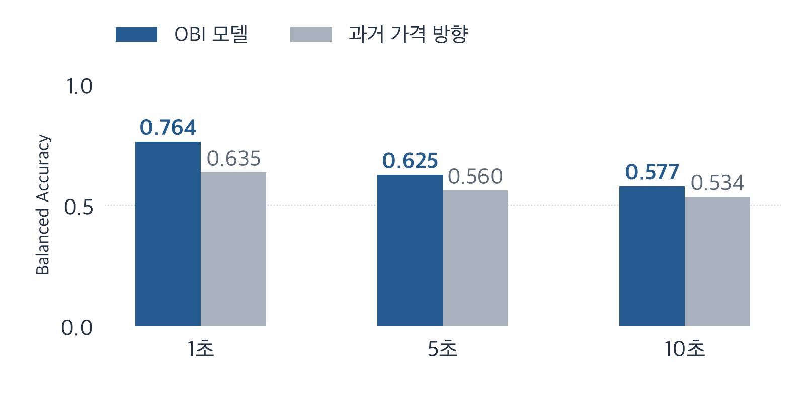
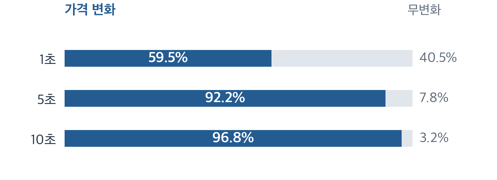

# BTC 호가에서 찾은 단기 가격 정보

Order Book Imbalance · Short-Horizon Price Prediction

**호가 수량 차이로 1·5·10초 뒤 가격 방향을 예측하고, 이후 데이터에서 검증했습니다.**

682,024건의 BBO · 28개 세션 · 2개 UTC 날짜

Python · scikit-learn · NumPy / PyArrow · Matplotlib

## 1초에서 가장 높고, 10초에서는 약해진 예측력



**OBI 0.764 → 0.625 → 0.577.** 각 구간의 기준 모델은 0.635 / 0.560 / 0.534입니다. 예측 점수의 차이는 실제 거래 수익의 차이가 아닙니다.

Balanced Accuracy는 상승·하락 재현율 평균이며 **미래 가격이 변한 표본만** 평가했습니다. 최종 구간은 2026-10-08 15:15–17:15 UTC이며, 모델을 다시 학습하지 않았습니다. 변화 표본은 1·5·10초에서 4,184 / 6,464 / 6,760개입니다.

## 점수가 설명하지 못하는 것



막대 전체는 각 예측 구간의 **유효 라벨 100%**입니다. 정확도 그래프가 아닙니다. 1초에서는 7,034개 중 2,850개가 무변화입니다. 가격 변화가 발생한 4,184개에서의 방향 Accuracy는 0.767이지만, 무변화를 포함해 같은 모델에 상승·하락을 강제로 선택시키면 전체 일치율은 0.456입니다. 분모와 예측 과제가 다릅니다.

5·10초의 유효 라벨은 각각 7,010·6,980개입니다. 조건부 모델은 **언제 가격이 움직일지, 실제 거래가 수익일지**를 입증하지 않습니다.

[지표·혼동행렬 원본](results/final_v1/primary_holdout.json) · [전체 라벨 분석](results/final_v1/exploration.json)

## 어떻게 검증했는가

1. **미래 정보 차단:** 해당 시점까지 수신한 호가만 사용하고, 오래되거나 시각이 잘못된 관측을 제외했습니다. 미래 라벨은 세션·UTC 날짜 경계를 넘지 않습니다.
2. **시간순 학습:** 초기 구간을 60/20/20으로 나누고 경계를 넘는 라벨을 제거했습니다. 스케일러와 분위수 경계는 학습 데이터로만 계산했습니다.
3. **모델 고정:** Logistic Regression의 계수·전처리·0.5 임계값을 유지한 채 이후 세션과 최종 구간을 평가했습니다. 결과를 보고 재학습하지 않았습니다.

OBI는 매수·매도 표시 수량의 상대적 차이입니다. Spread와 Microprice도 비교했지만 일관된 큰 개선은 없었습니다. 최종 구간은 앞선 다음 날 세션보다 점수가 낮았으며, 가격 평가 구간을 1초 늦춘 분석에서도 예측력이 약해졌습니다. 실제 주문 지연 측정은 아닙니다.

[평가 protocol](research/final_v1/PROTOCOL.md) · [고정 모델](results/oos/frozen_models.json) · [전체 결과와 신뢰구간](research/final_v1/REPORT.md)

## 실행과 재현

Python 3.11+. 원시 데이터나 API Key 없이 공개 계산·집계 검증을 실행할 수 있습니다.

```bash
git clone https://github.com/Min9s/orderbook-imbalance-research.git
cd orderbook-imbalance-research
python3 -m venv .venv
source .venv/bin/activate
python -m pip install -e '.[dev]'
python -m pytest -q
python examples/verify_public_results.py
python -m pip check
```

**33개 공개 테스트**는 계산·시간 조건·집계 결과의 일관성을 검증합니다. 원시 데이터 실험이나 ROC-AUC·신뢰구간을 재구성하는 검사는 아닙니다. 같은 과거 실험의 전체 재실행에는 비공개 archive가 필요합니다. [데이터 접근 안내](research/final_v1/DATA_ACCESS.md)

그림은 `python assets/readme/generate_figures.py`로 다시 생성합니다. Matplotlib과 지원 한국어 글꼴이 필요하며, 원본 JSON을 읽기만 합니다.

## 범위와 한계

자료는 2026-10-07/08 UTC **이틀**뿐이며 최종 구간도 이미 관측한 날짜의 뒤쪽입니다. 독립적인 새 거래일의 일반화는 확인하지 못했습니다. 시간 블록 신뢰구간은 고정 모델과 관측 세션에 조건부이며, 중첩 라벨·시각 품질에 따른 표본 제외도 해석을 제한합니다.

실제 체결·queue position·slippage·시장 충격·지급 수수료·PnL은 검증하지 않았습니다. 비용 가정과 spread 비교는 수익성 입증이 아닙니다. 이미 사용한 holdout은 새로운 미사용 검증 자료로 취급할 수 없습니다.

[전체 보고서](research/final_v1/REPORT.md) · [한국어 요약](research/final_v1/SUMMARY_KO.md) · [공개 범위](PUBLICATION.md) · [출처·AI 보조 사용](PROVENANCE.md)

[특징 계산](src/obi_research/features.py) → [고정 모델 평가](research/oos.py) → [최종 평가](research/final_v1/run.py)

기존 실험 결과·모델·그림은 변경하지 않았습니다. 공개 소스 포트폴리오이며 별도 open-source LICENSE나 원시 데이터 재배포 권한을 주장하지 않습니다.
