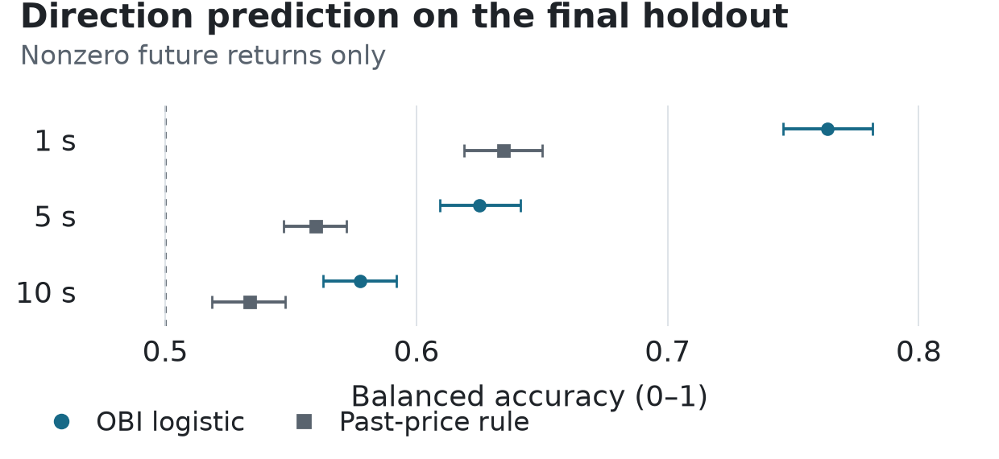

# Order Book Imbalance Research

An empirical study of whether top-of-book imbalance predicts BTC mid-price changes over 1-, 5-, and 10-second horizons. The archive contains 682,024 best-bid-and-offer observations from Hyperliquid BTC perpetuals across 28 sessions on two UTC dates.

A frozen OBI logistic model outperformed both baselines on the final temporal holdout. Its directional discrimination weakened at longer horizons. The result is conditional on a future price change; it does not establish profitable execution.

## Main results

Final holdout: **2026-10-08, 15:15:56–17:15:56 UTC**, containing 77,143 BBO observations. Scores below use only valid labels with a nonzero future mid-price return. Both baselines and OBI are evaluated on identical rows within each horizon.

Balanced accuracy by horizon:

| Horizon | N | OBI | Past price |
|---|---:|---:|---:|
| 1 s | 4,184 | 0.764 | 0.635 |
| 5 s | 6,464 | 0.625 | 0.560 |
| 10 s | 6,760 | 0.577 | 0.534 |

Balanced accuracy (BA) is the mean of up and down recall. The past-price rule uses the previous 1-second return's sign, falling back to the frozen training prior when flat or unavailable. The training-prior baseline always predicts up (BA 0.500 at every horizon).

<picture>
  <source media="(max-width: 600px)" srcset="assets/readme/holdout-mobile.png">
  <source media="(prefers-color-scheme: dark)" srcset="assets/readme/holdout-dark.png">
  
</picture>

Intervals: pointwise 95% bootstrap estimates using 60-second clock blocks and 1,000 replicates, conditional on the frozen models and this interval. Dashed line: constant-direction BA. [Source values](results/final_v1/primary_holdout.json) · [Figure script](assets/readme/plot_holdout.py)

## Interpretation

The model distinguishes up from down among observations that subsequently move. It does not predict which observations will move. At 1 second, 2,850 of 7,034 valid labels (40.5%) are unchanged and excluded from the directional scores above.

On the moving subset, OBI's ordinary accuracy is 0.767. Forcing an up/down prediction over all 7,034 labels gives 0.456 agreement, because unchanged outcomes cannot match either prediction. This changes both the denominator and the target; it is not an all-observation version of balanced accuracy.

Predictive performance is not trading performance. No fills, queue position, paid fees, slippage, or PnL were measured. A separate training-bin magnitude forecast never exceeded the quoted spread plus an assumed 1 bp round-trip cost. A predeclared one-second deferral of the evaluated mid-price window reduced 1-second BA to 0.605; that sensitivity is still not an execution simulation.

## Method

The feature is `OBI = (bid_size − ask_size) / (bid_size + ask_size)` at the best quotes. Spread and microprice features were also tested, with little improvement in final classifications.

Features use the latest quote received by each decision time. Quote age and exchange-to-receive differences must be at most two seconds; invalid states are excluded. Forward log-mid returns require a valid path and cannot cross sessions or UTC dates.

The initial 60/20/20 split is chronological, with forward labels purged at split boundaries. Scaling and bin cutoffs use training data only. Coefficients, preprocessing, and the 0.5 decision threshold remain frozen for later evaluations. Model, protocol, and analysis hashes record what was evaluated.

The primary endpoint was 1-second OBI BA against the original training-prior baseline. Other horizons and the past-price comparison provide context. [Experimental protocol](research/final_v1/PROTOCOL.md) · [Frozen models](results/oos/frozen_models.json)

[Timing and statistical audit](research/STATISTICAL_AUDIT.md) · [Receipt-tie hardening and versioned preprocessing](research/RECEIPT_TIES.md) · [Implementation](src/obi_research/) · [Tests](tests/)

## Reproduction

Python 3.11+. These commands verify published aggregates, temporal rules, and recorded hashes without API keys or the private market archive.

```bash
git clone https://github.com/Min9s/orderbook-imbalance-research.git
cd orderbook-imbalance-research
python3 -m venv .venv
source .venv/bin/activate
python -m pip install -e '.[dev]'
python -m pytest -q
python examples/verify_public_results.py
python examples/verify_publication.py
python -m pip check
```

This checks consistency, not a replay of the market experiment. Reconstructing price paths, ranking AUC, and bootstrap intervals requires the unchanged private archive. See [data access](research/final_v1/DATA_ACCESS.md) and [reproduction records](research/final_v1/VERIFICATION.md). Regenerate the README figure with `python assets/readme/plot_holdout.py`.

[Public verification CI](https://github.com/Min9s/orderbook-imbalance-research/actions/workflows/public-verification.yml) runs the public checks without private inputs. Publication verification also checks the original snapshot in Git history; shallow clones must fetch that history first. See [publication manifests and historical records](PUBLICATION.md#publication-manifests-and-historical-records).

## Full research and limitations

The archive covers two dates, not 28 independent days. The final holdout is later on an already observed date and is now consumed. Performance was lower than in the first next-day session. Overlapping labels, a small initial training sample, clock-related exclusions, and dependence within sessions limit generalization. The intervals do not include training-estimation uncertainty or establish performance across independent days.

- [Full report and detailed figures](research/final_v1/REPORT.md): data quality, validation, robustness, and execution diagnostics.
- [All-observation results](results/final_v1/exploration.json) and [session summaries](results/final_v1/summary_tables.json).
- [Detailed Korean summary](research/final_v1/SUMMARY_KO.md).
- [Publication scope](PUBLICATION.md) and [provenance and AI assistance](PROVENANCE.md).

Raw and event-level data are not redistributed. Public availability does not grant an open-source or source-data license.
