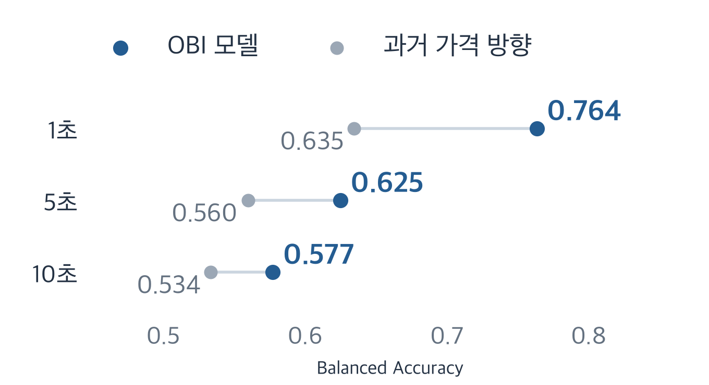
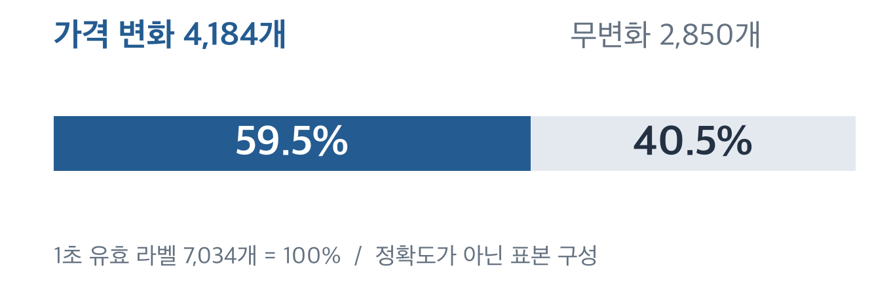
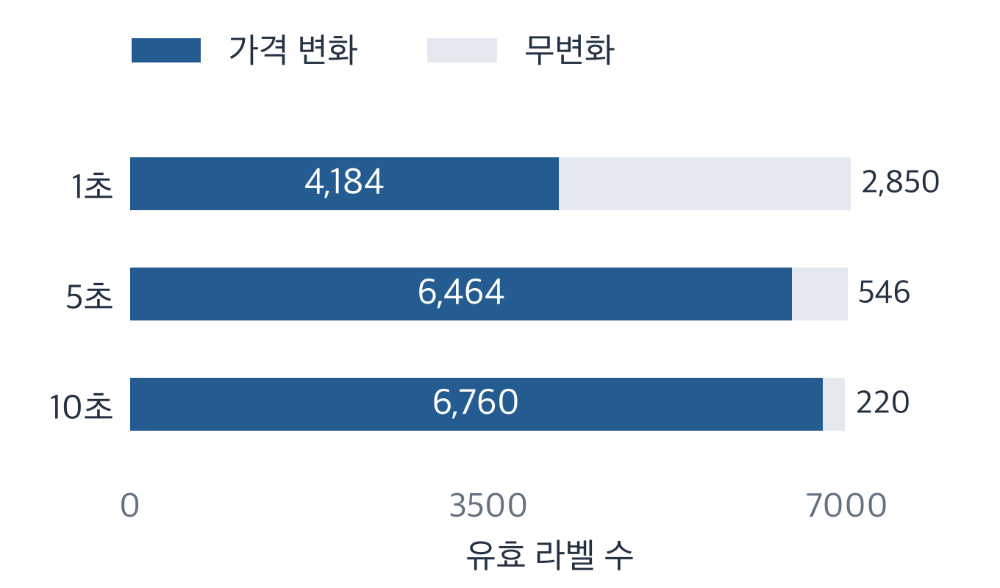

# Order Book Imbalance Research

**호가 수량의 차이가 몇 초 뒤 가격 방향을 예측하는가?** 학습한 모델을 고정하고 이후 데이터에서 확인했습니다.

682,024건의 BBO, 28개 세션, 2개 UTC 날짜

Python · scikit-learn · NumPy / PyArrow · Matplotlib

**관찰:** OBI는 과거 가격 방향 기준 모델보다 높은 조건부 Balanced Accuracy를 보였습니다. 다만 무변화 시점을 제외한 결과이며, 거래 수익성은 검증하지 않았습니다.

[최종 보고서](research/final_v1/REPORT.md) · [평가 사전 규칙](research/final_v1/PROTOCOL.md) · [공개 검산](examples/verify_public_results.py)

## 발견 1 · 방향 정보는 짧은 구간에서 강했습니다

최종 구간의 Balanced Accuracy입니다. **미래 가격이 실제로 변한 표본만** 평가합니다. BA는 상승·하락 각각의 재현율 평균입니다.



OBI는 1·5·10초에서 **0.764, 0.625, 0.577**로 낮아졌고, 각 구간의 과거 1초 가격 방향 기준 모델보다 높았습니다. 회색 선은 두 모델의 점수를 연결하며 신뢰구간이 아닙니다. 점수 차이는 거래 수익의 차이가 아닙니다.

최종 평가: 2026-10-08 15:15:56–17:15:56 UTC, BBO 77,143건. 가격 변화 표본은 1·5·10초에서 4,184 / 6,464 / 6,760개입니다. [지표·혼동행렬](results/final_v1/primary_holdout.json) · [신뢰구간·전체 결과](research/final_v1/REPORT.md)

## 발견 2 · 방향을 맞히는 것과 움직임을 맞히는 것은 다릅니다



변화가 발생한 4,184개에서의 방향 Accuracy는 0.767입니다. 무변화를 포함한 7,034개에서 같은 모델에 상승·하락을 강제로 선택시키면 전체 일치율은 0.456입니다. **평가 대상과 분모가 다른 두 과제**이므로 같은 정확도처럼 비교하지 않습니다.

조건부 방향 모델은 언제 가격이 움직일지, 실제 거래가 수익일지를 입증하지 않습니다. 5·10초의 유효 라벨은 7,010 / 6,980개이며 전체 표본 분석은 [별도 결과](results/final_v1/exploration.json)에 보존했습니다.

## 발견 3 · 예측 구간에 따라 평가 대상도 달라집니다



각 막대의 전체 길이는 해당 구간의 유효 라벨 수입니다. 긴 구간에서는 무변화 비중이 줄지만, 경계와 품질 필터 때문에 전체 표본 수도 달라집니다. 정확도를 표시한 그래프가 아닙니다.

## 관측 → 시간순 학습 → 모델 고정 → 이후 구간 평가

Hyperliquid BTC perpetual의 최우선 매수·매도 호가를 사용했습니다. OBI는 표시된 매수·매도 수량의 상대적 차이입니다. 주문이 한쪽에 더 많이 대기한 상태가 이후 중간가격의 상승·하락과 관련 있는지 확인했습니다.

1. **시점에 맞는 데이터:** 당시까지 수신한 마지막 호가를 사용하고, 오래되거나 시각이 잘못된 관측을 제외했습니다. 라벨은 세션·UTC 날짜 경계를 넘지 않습니다.
2. **시간순 학습:** 초기 구간을 60/20/20으로 나누고 경계를 넘는 미래 라벨을 제거했습니다. 스케일러와 분위수 경계는 학습 구간에서만 계산했습니다.
3. **고정 모델 검증:** Logistic Regression의 계수·전처리·0.5 임계값을 유지한 채 이후 세션과 최종 구간을 평가했습니다. protocol·소스·모델 해시를 기록하고 시간 블록으로 불확실성을 평가했습니다.

Spread·Microprice도 비교했지만 일관된 큰 개선은 없었습니다. 최종 구간은 앞선 다음 날 세션보다 점수가 낮았습니다. 특징 시점은 고정한 채 가격 평가 구간을 1초 늦춘 분석에서도 예측력이 약해졌습니다. 실제 주문 지연을 측정한 결과는 아닙니다.

[평가 protocol](research/final_v1/PROTOCOL.md) · [특징·시간 분할 코드](src/obi_research/features.py) · [고정 모델 평가](research/oos.py) · [최종 평가](research/final_v1/run.py)

## 공개 결과를 직접 검산하기

Python 3.11+. 원시 데이터나 API Key 없이 공개 계산·집계 검증을 실행할 수 있습니다.

```bash
git clone https://github.com/Min9s/orderbook-imbalance-research.git
cd orderbook-imbalance-research
python3 -m venv .venv
source .venv/bin/activate
python -m pip install -e '.[dev]'
python -m pytest -q
python examples/verify_public_results.py
python -m pip check
```

**33개 공개 테스트**는 계산·시간 조건·집계 결과의 일관성을 확인합니다. 원시 데이터 실험이나 ROC-AUC·신뢰구간을 재구성하는 검사는 아닙니다. 같은 과거 실험의 전체 재실행에는 비공개 archive가 필요합니다. [데이터 접근 안내](research/final_v1/DATA_ACCESS.md)

README 그림은 `python assets/readme/generate_figures.py`로 생성합니다. Matplotlib과 지원 한국어 글꼴이 필요하며 기존 JSON을 읽기만 합니다.

## 예측에서 체결까지, 아직 검증하지 않은 부분

자료는 2026-10-07/08 UTC **이틀**뿐이며 최종 구간도 이미 관측한 날짜의 뒤쪽입니다. 독립적인 새 거래일의 일반화는 확인하지 못했습니다. 시간 블록 신뢰구간은 고정 모델과 관측 세션에 조건부이며, 중첩 라벨·시각 품질에 따른 제외도 해석을 제한합니다.

실제 체결·queue position·slippage·시장 충격·지급 수수료·PnL은 검증하지 않았습니다. 비용 가정과 spread 비교는 수익성 입증이 아닙니다. 이미 사용한 holdout은 새로운 미사용 검증 자료로 취급할 수 없습니다.

[전체 보고서](research/final_v1/REPORT.md) · [한국어 요약](research/final_v1/SUMMARY_KO.md) · [재현 기록](research/final_v1/VERIFICATION.md) · [공개 범위](PUBLICATION.md) · [출처·AI 보조 사용](PROVENANCE.md)

기존 실험 결과·모델·그림은 보존했습니다. 공개 소스 포트폴리오이며 별도 open-source LICENSE나 원시 데이터 재배포 권한을 주장하지 않습니다.
