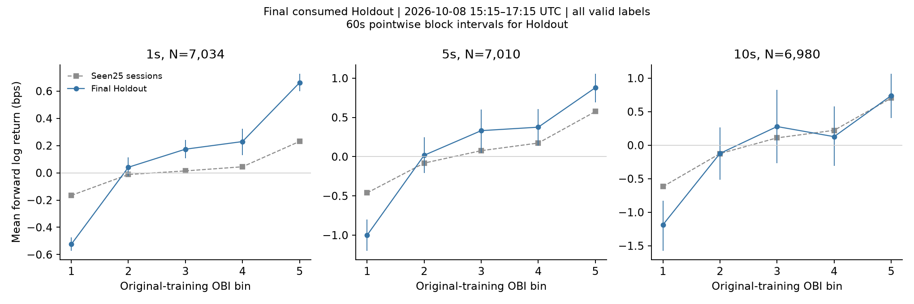
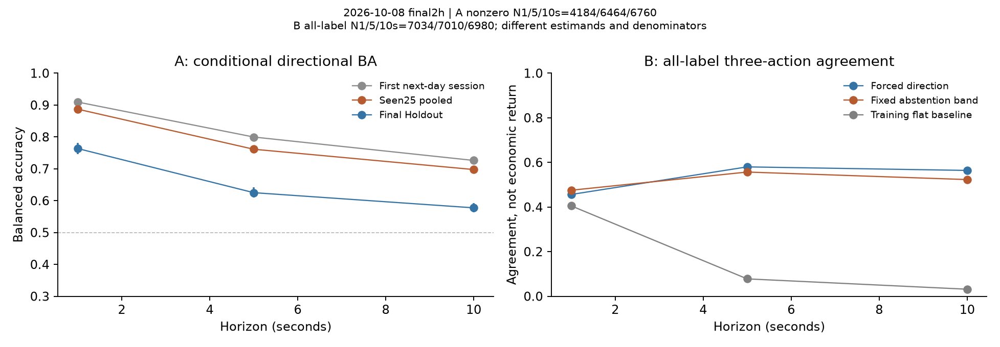
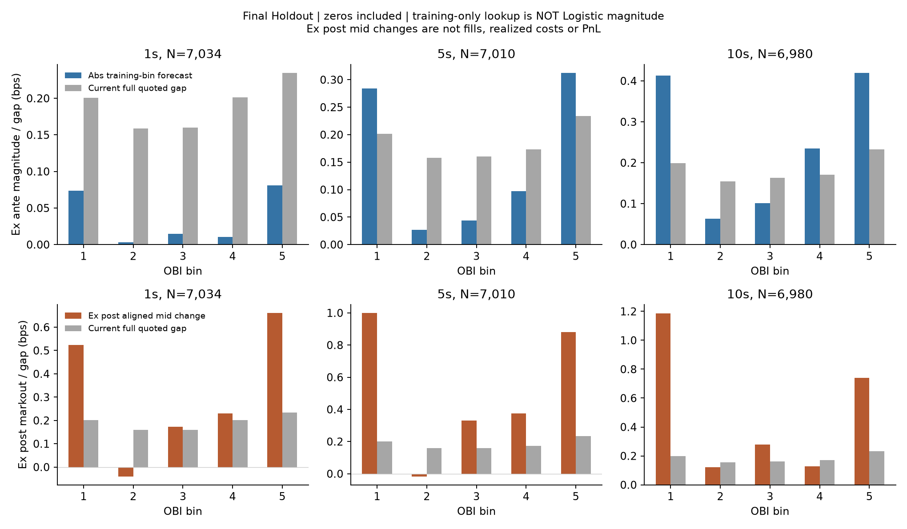
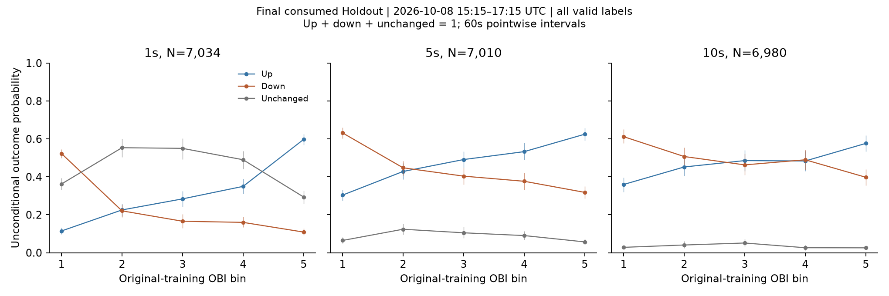

# Order Book Imbalance & Short-Horizon Price Predictability

A BTC microstructure study of **conditional direction prediction, all-observation information, and execution limits**. Frozen-model performance deteriorates in the final temporal holdout; predictability does not establish profitable execution.

[Research report](research/final_v1/REPORT.md) · [한국어 요약](research/final_v1/SUMMARY_KO.md) · [Evaluation protocol](research/final_v1/PROTOCOL.md)

## Research Question

Does best-level order book imbalance predict short-term BTC mid-price movements?

We distinguish **A: direction conditional on a nonzero future return** from **B: information and decision coverage over all valid observations**. A binary direction score does not estimate when a move will occur.

## Data & Methodology

- **Source:** observed Hyperliquid BTC perpetual BBO; 682,024 updates across 28 sessions on **2026-10-07/08 UTC**, not 28 trading days.
- **Features:** `mid=(bid+ask)/2`, `spread=ask−bid`, `OBI=(bid_size−ask_size)/(bid_size+ask_size)`. Microprice offset equals `OBI×spread/2`.
- **Timing:** one-second receive-time as-of sampling; exact 1/5/10-second labels; finite positive quotes/sizes; receipt age ≤2s; exchange–receive difference in [0,2]s; valid full label path; no interpolation or cross-session/date labels.
- **Models:** original-training Logistic on OBI, or OBI+Spread+Microprice; training-only scaler and quintile cutoffs; fixed threshold 0.5. Baselines use the training up-prior or past one-second price direction.
- **Evaluation:** chronological 60/20/20 pilot split with strict purging, fixed-model external validation, then a pre-recorded final-holdout protocol. Paired clock-block intervals account for dependence; 60s main, 30/120s and alignment sensitivities disclosed.

The small reused quote function is included locally. Neither Liquidation Gravity nor the OMS repository is a runtime dependency. [Data-quality and reuse audit](research/ASSET_AUDIT.md).

## Key Findings

| Horizon | Final valid labels | Nonzero outcomes | Conditional OBI BA [60s pointwise 95% CI] | Past-price BA | OBI ROC-AUC |
|---|---:|---:|---|---:|---:|
| 1s | 7,034 | 4,184 | **0.764 [0.746, 0.781]** | 0.635 | 0.841 |
| 5s | 7,010 | 6,464 | **0.625 [0.609, 0.641]** | 0.560 | 0.673 |
| 10s | 6,980 | 6,760 | **0.577 [0.563, 0.592]** | 0.534 | 0.611 |

These scores exclude zero returns. At 1s, conditional Accuracy is **0.767**, while forced-direction agreement over all 7,034 labels is **0.456**; 2,850 prices are unchanged. Feature coverage is 97.79%, and the nonzero-outcome fraction is 59.5%. The fixed exploratory abstention band still acts on 93.7% of valid feature times and does not learn a move detector.

OBI extremes retain different unconditional mean returns and direction probabilities. The final 10s middle-bin means are not monotone. Added Spread/Microprice features show no consistent material improvement. All models, class counts, confusion matrices and paired improvement intervals are in the [report](research/final_v1/REPORT.md) and [aggregate records](results/final_v1/primary_holdout.json).



## Out-of-Sample Validation

The final 77,143-update interval is **2026-10-08 15:15:56–17:15:56 UTC**. Models, preprocessing and thresholds were unchanged. The holdout is now permanently consumed.

| Evaluation period | 1s BA | 5s BA | 10s BA |
|---|---:|---:|---:|
| Earlier next-day session | 0.909 | 0.800 | 0.726 |
| Previously seen 25 chronological sessions, pooled | 0.887 | 0.761 | 0.698 |
| Final temporal holdout | **0.764** | **0.625** | **0.577** |

The final period is later in time on an already observed date, **not a third independent day**. Different move frequencies and sample sizes limit direct attribution of performance changes. Sparse and undefined session scores remain disclosed; a pre-training interval was transparently excluded from chronological aggregates. No favorable sessions were selected after scoring.



## Execution Feasibility

The binary Logistic does not predict return magnitude. A separate exploratory lookup uses **original-training OBI-bin mean returns**, fixed before final disclosure. Mean absolute forecasts are 0.053/0.212/0.316 bps versus current mean quoted gaps 0.199/0.196/0.195 bps. No 1s forecast exceeds the gap. Some 5/10s forecasts do, but none exceed the gap plus an **assumed** 1bp total round-trip cost. This is not an exchange fee estimate or a profitability test.

Keeping the original feature at t but deferring the markout to `log(M(t+1+h)/M(t+1))` lowers conditional BA to **0.605/0.558/0.535**. Benchmark quotes must be observed after t. This changes the target/cohort and assumes deferral; it does not measure order-entry latency or execution prices.



## Limitations

- Only **two UTC dates**: clock-block intervals condition on fixed models and the observed session composition. They do not quantify independent-day generalization, training uncertainty or multiplicity-adjusted significance.
- Conditional-on-move classification, overlapping labels, persistent state, clock-quality exclusions and unverified absolute clock alignment constrain interpretation. The score is not a calibrated unconditional up-probability.
- BBO does not establish queue position, fills, slippage, own-order impact, unfilled-order risk or paid fees. Signed mid markouts and gap comparisons are not executed returns or PnL.



## Reproduction

Python **3.11+**. Public checks require no raw market data or original project:

```bash
python3 -m venv .venv
source .venv/bin/activate
python -m pip install -e '.[dev]'
python -m pytest -q
python examples/verify_public_results.py
python -m pip check
```

The example checks published aggregates and recorded model/source hashes; it **does not rerun the historical experiment or reconstruct ranking AUC/clock quality from matrices**. Tests use invented quotes for calculation contracts and published aggregates for consistency. Event-level prediction files are optional private audit inputs and are not distributed.

**Full empirical replay requires the unchanged private BBO archive.** There is no verified public download or redistribution grant for these exact historical inputs. Code, model parameters, aggregate evidence and figures are included; raw data, event-level records, manifests, local paths, environments and caches are excluded. See [data access](research/final_v1/DATA_ACCESS.md) and [publication scope](PUBLICATION.md).

```bash
# Requires the original complete archive; does not fit or tune a model.
python research/final_v1/rebuild_manifest.py --bbo-root /path/to/bbo/BTC
python research/final_v1/run.py replay --bbo-root /path/to/bbo/BTC
python research/final_v1/run.py explore --bbo-root /path/to/bbo/BTC
python research/final_v1/report.py --bbo-root /path/to/bbo/BTC
```

Replay verifies an already consumed holdout; it cannot make it unused again. Fingerprints and local historical byte-repeatability checks are recorded in [verification](research/final_v1/VERIFICATION.md). `requirements-audit.txt` records the tested Python 3.11 environment; a clean installation resolves supported dependencies independently.

## Research Report

- [English report: hypotheses, data quality, predictive results, robustness and execution limits](research/final_v1/REPORT.md)
- [한국어 주요 결론](research/final_v1/SUMMARY_KO.md)
- [Evaluation protocol](research/final_v1/PROTOCOL.md) · [Frozen parameters](results/oos/frozen_models.json)
- [Portfolio introduction, resume bullets and interview notes](PORTFOLIO.md)
- [Source provenance and publication status](PROVENANCE.md)

This is a public source portfolio; no open-source license or raw-data redistribution license is asserted. AI-assisted implementation and analysis are disclosed in the provenance record.
