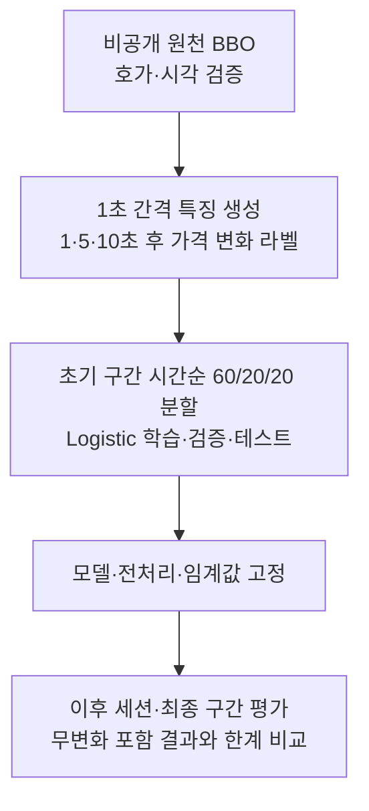

# Order Book Imbalance & Short-Horizon Price Prediction

**매수·매도 호가 수량의 차이가 몇 초 뒤 BTC 가격 방향을 예측하는 데 도움이 되는지 분석한 Python 프로젝트**입니다.
최우선 매수·매도 호가(BBO) 682,024건에서 OBI·Spread·Microprice를 계산하고, 1초·5초·10초 후 중간가격 변화를 평가했습니다.
시간순 학습과 데이터 누수 방지, 학습된 모델을 바꾸지 않는 이후 구간 평가를 구현했습니다.
최종 구간에서는 앞선 평가보다 예측력이 약해졌으며, **방향 예측 점수와 실제 거래 수익성은 구분**합니다.

## 데이터와 분석 흐름

원천 자료는 **Hyperliquid BTC perpetual BBO, 2026-10-07/08 UTC의 28개 세션·682,024건**입니다.
28개 거래일이나 연속 관측 자료가 아니며, 날짜는 이틀뿐입니다.



| 변수 | 의미 |
|---|---|
| Order Book Imbalance (OBI) | `(bid_size − ask_size) / (bid_size + ask_size)`: 최우선 매수·매도 수량의 상대적 차이 |
| Spread | `ask − bid`: 최우선 매수·매도 가격 간격 |
| Microprice | `(ask × bid_size + bid × ask_size) / (bid_size + ask_size)`: 표시 수량을 반영한 가격 |

예측 대상은 현재와 **1·5·10초 후 중간가격** `mid=(bid+ask)/2` 사이의 로그 수익률 방향입니다. 호가 이벤트 개수가 아닌 실제 초 단위를 사용합니다.
Logistic Regression으로 OBI 단독 모델과 OBI+Spread+Microprice 모델을 비교합니다.
학습 구간 상승 비율과 과거 1초 가격 방향을 기준 모델로 둡니다.
Microprice offset은 `OBI × Spread / 2`이므로 독립적인 새 데이터가 아닙니다.

## 미래 정보 사용을 막는 방법

- 각 시점까지 **수신한 마지막 호가만** 사용합니다. 수신 후 2초 초과, 거래소–수신 시각 차이 범위 [0, 2]초 이탈, 유효하지 않은 호가는 제외하며 보간하지 않습니다.
- 미래 가격까지 중간 경로가 유효해야 하며, 세션·UTC 날짜 경계를 넘는 라벨은 만들지 않습니다.
- 초기 42분 구간을 경과 시간 기준 60/20/20으로 분리하고, 다음 구간에 걸치는 미래 라벨을 앞 구간에서 제거합니다(purging).
- 스케일러·분위수 경계는 학습 데이터에서만 계산합니다. Logistic 설정은 `C=1`, `lbfgs`, `max_iter=2000`, 방향 임계값은 0.5입니다.
- 이후 평가에서는 저장한 계수·전처리·임계값을 유지합니다. 최종 평가 전에 protocol과 소스·모델 해시를 기록했으며, 이미 평가한 holdout을 다시 미사용 데이터로 취급하지 않습니다.

자세한 조건은 [평가 protocol](research/final_v1/PROTOCOL.md)과 [고정 모델](results/oos/frozen_models.json)에 있습니다.

## 주요 결과

최종 평가 구간은 **2026-10-08 15:15:56–17:15:56 UTC, BBO 77,143건**입니다.
아래 Balanced Accuracy(BA)는 상승·하락 각각의 재현율 평균이며, **미래 가격이 변한 경우만** 평가한 값입니다.

| 구간 | 유효 라벨 / 가격 변화 발생 | OBI BA [95% 구간] | 과거 가격 방향 BA |
|---|---:|---|---:|
| 1초 | 7,034 / 4,184 | 0.764 [0.746, 0.781] | 0.635 |
| 5초 | 7,010 / 6,464 | 0.625 [0.609, 0.641] | 0.560 |
| 10초 | 6,980 / 6,760 | 0.577 [0.563, 0.592] | 0.534 |

95% 구간은 60초 시간 블록을 재표본추출한 pointwise 구간입니다. 고정 모델과 관측 세션에 조건부이며, 새로운 거래일에 대한 일반화나 여러 비교를 보정한 유의성을 보장하지 않습니다.

**가격 무변화를 포함하면 평가 대상이 달라집니다.** 다음은 BA가 아닌 단순 일치율(Accuracy)입니다. 전체 평가에서는 동일 모델이 매번 상승·하락을 선택하므로 무변화는 맞힐 수 없습니다.

| 구간 | 무변화 라벨 | 변화 발생 시 방향 Accuracy | 무변화 포함 전체 강제 방향 일치율 |
|---|---:|---:|---:|
| 1초 | 2,850 | 0.767 | 0.456 |
| 5초 | 546 | 0.629 | 0.580 |
| 10초 | 220 | 0.582 | 0.564 |

- 앞선 다음 날 세션의 BA 0.909/0.800/0.726보다 최종 BA는 낮았습니다. 세션 길이·가격 변화 빈도도 달라 하락 원인을 하나로 단정하지 않습니다.
- Spread·Microprice 추가는 일관된 큰 개선을 보이지 않았습니다. OBI 극단 구간의 차이는 관찰되지만 최종 10초 중간 구간의 평균 수익률은 단조롭지 않았습니다.
- 특징은 원래 시점에 고정하고 가격 평가 구간만 1초 늦추면 BA는 0.605/0.558/0.535였습니다. 평가 대상·표본도 달라지며 **실제 주문 지연 측정이 아닙니다.**

근거: [최종 지표·혼동행렬](results/final_v1/primary_holdout.json), [전체 라벨·지연 분석](results/final_v1/exploration.json), [전체 보고서·그림·추가 비교](research/final_v1/REPORT.md).

## 설치와 공개 검증

Python **3.11+**가 필요합니다. 다른 프로젝트나 API Key·원시 시장 데이터 없이 테스트와 공개 집계 검증을 실행할 수 있습니다.

```bash
git clone https://github.com/Min9s/orderbook-imbalance-research.git
cd orderbook-imbalance-research
python3 -m venv .venv
source .venv/bin/activate
python -m pip install -e '.[dev]'
python -m pytest -q
python examples/verify_public_results.py
python -m pip check
```

**공개 테스트 33개**는 합성 호가로 계산·시간 경계·미래 정보 차단을 검증하고, 공개 결과의 혼동행렬·분모·고정 모델·소스 해시를 확인합니다.
집계 검증 예제는 12개 모델/예측 구간 조합을 확인합니다. 원시 데이터 실험을 재실행하거나 혼동행렬에서 ROC-AUC·시각 품질·신뢰구간을 재구성하는 검사는 아닙니다.
권장 설치는 위 `pyproject.toml` 기반 명령입니다. `requirements-audit.txt`와 `requirements-reproduction.txt`는 서로 다른 과거 실험 환경 기록으로 보존합니다.

## 파일 구조와 코드 읽기 순서

```text
src/obi_research/
  features.py                    # 호가 검증·수신 시점 특징·미래 라벨·시간 분할
  legacy_book.py                 # 재사용한 기본 호가 계산
  statistics.py                  # 평가 지표·시간 블록 재표본추출
research/
  run.py                         # 초기 학습·분석
  audit.py                       # 초기 결과 검산
  oos.py                         # 모델 고정·이후 세션 평가
  final_v1/run.py                 # 최종 protocol·holdout·전체 라벨·지연 분석
  final_v1/REPORT.md              # 상세 결과와 해석
results/                         # 초기·외부·최종 평가의 집계 근거와 그림
tests/                           # 계산·시간 조건·고정 모델·결과 일관성
examples/verify_public_results.py # 원시 데이터 없이 집계 결과 검증
PUBLICATION_FILES.json           # 공개 파일 크기·SHA-256 목록
```

**추천 순서:** [특징 계산](src/obi_research/features.py) → [계산·시간 조건 테스트](tests/test_research.py) → [초기 학습](research/run.py) → [고정 모델 평가](research/oos.py) → [최종 평가](research/final_v1/run.py) → [최종 검증 테스트](tests/test_final.py).
먼저 결과를 확인하려면 [공개 집계 검증 예제](examples/verify_public_results.py)를 실행하세요.

## 공개 자료와 전체 재실험의 차이

| 공개 저장소에 포함 | 별도 비공개 입력이 필요한 것 |
|---|---|
| 코드·합성 테스트·저장 모델·protocol·집계 통계·그림 | 원시 BBO archive·행별 예측·입력 파일 manifest·실행 로그 |
| 계산과 공개 집계의 일관성 검증 | 동일한 과거 시장 데이터 전체 재실험 |

정확히 같은 원시 데이터의 공개 다운로드 경로나 재배포 권한은 확인되지 않아 원시·행별 자료를 배포하지 않습니다.
전체 재실험에는 변경되지 않은 원본 archive가 필요하며, [데이터 접근·재실험 명령](research/final_v1/DATA_ACCESS.md)을 따릅니다.
새 데이터 수집은 방법을 재현할 수 있지만 같은 과거 수치를 재현하지는 않습니다.

## 해석의 한계

- 데이터는 이틀뿐이며 최종 구간도 이미 관측한 날짜의 뒤쪽입니다. 독립적인 새 거래일의 검증이 아닙니다.
- 미래 가격이 변할지는 의사결정 시점에 알 수 없습니다. 조건부 방향 점수는 무조건적인 상승 확률이나 매매 성공률이 아닙니다.
- Logistic은 가격 변화 크기를 예측하지 않습니다. 별도 학습 구간 OBI 분위수 평균과 spread를 비교했지만, 가정한 왕복 비용 1bp를 더하면 이를 넘는 예측은 없었습니다. 이는 실측 수수료나 수익성 검증이 아닙니다.
- 실제 체결·queue position·slippage·시장 충격·지급 수수료·PnL을 검증하지 않았습니다. 호가·중간가격 변화에서 실현 수익을 주장하지 않습니다.
- 중첩 라벨·지속적인 호가 상태·시각 품질에 따른 제외·미검증 절대 시계 정렬이 해석을 제한합니다.

[한국어 연구 요약](research/final_v1/SUMMARY_KO.md) · [영문 소개·면접과 문서 안내](PORTFOLIO.md) ·
[재현 기록](research/final_v1/VERIFICATION.md) · [공개 범위](PUBLICATION.md) · [출처·AI 보조 사용](PROVENANCE.md)

별도 open-source LICENSE나 원시 데이터 재배포 라이선스를 주장하지 않는 공개 소스 포트폴리오입니다.
