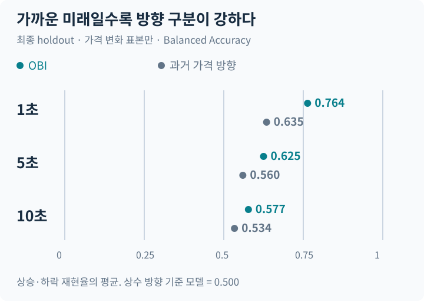
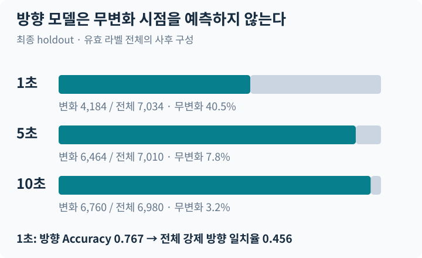
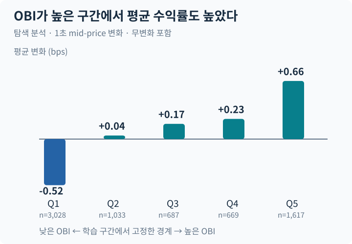
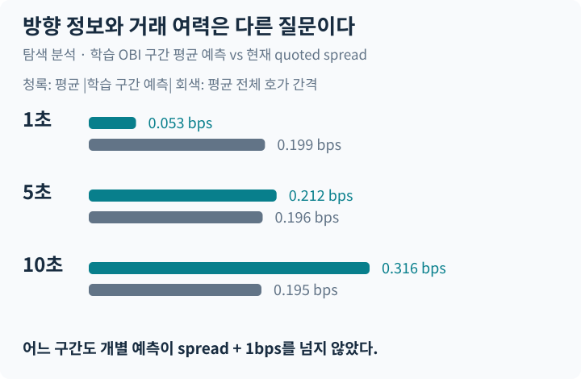

# Order Book Imbalance Research

**매수 호가에 더 많은 수량이 쌓이면, 몇 초 뒤 가격도 오를까?**

BTC 최우선 호가 682,024건에서 Order Book Imbalance의 단기 방향 정보를 분석했습니다. Logistic Regression을 학습한 뒤 계수와 전처리를 고정하고 이후 구간에서 평가했습니다.

**결과는 방향 정보의 존재와 거래 가능성의 한계를 함께 보여줍니다.** 최종 구간에서 OBI는 과거 가격 방향 기준 모델보다 높았지만, 긴 예측 구간에서 성능이 약해졌습니다. 무변화 시점과 거래 비용을 고려하면 해석은 달라집니다.

Python · scikit-learn · NumPy / PyArrow · 28개 세션 · 2개 UTC 날짜

[전체 연구 보고서](research/final_v1/REPORT.md) · [사전 평가 규칙](research/final_v1/PROTOCOL.md) · [공개 검산 코드](examples/verify_public_results.py)

## 방향 정보는 어디까지 남는가



OBI의 Balanced Accuracy는 1·5·10초에서 **0.764 → 0.625 → 0.577**로 낮아졌습니다. 같은 구간·같은 표본의 과거 1초 가격 방향 모델보다 높았습니다. BA는 상승·하락 재현율의 평균이며, 거래 수익률이 아닙니다.

최종 평가 구간은 **2026-10-08 15:15:56–17:15:56 UTC**, BBO 77,143건입니다. 방향 표본은 각각 4,184 / 6,464 / 6,760개입니다. [원본 지표·혼동행렬](results/final_v1/primary_holdout.json)

앞선 다음 날 세션의 OBI BA는 0.909 / 0.800 / 0.726이었습니다. 최종 구간에서는 모두 낮아졌지만 두 구간은 표본 수·무변화 비중이 다릅니다. 같은 시장 조건의 반복 실험이나 독립적인 새 거래일 검증으로 해석하지 않습니다. [시간 구간별 비교와 block 신뢰구간](research/final_v1/REPORT.md#8-out-of-sample-validation)

## 평가에서 빠진 시점이 있다



조건부 평가는 미래에 가격이 변한 시점만 사용합니다. **예측 시점에는 이 표본을 미리 골라낼 수 없습니다.** 1초에서 변화 표본의 방향 Accuracy 0.767은, 무변화를 포함해 상승·하락을 강제 선택하면 전체 일치율 0.456이 됩니다. BA와 이 일치율을 같은 지표로 비교하지 않습니다.

표본 구성은 사후 결과이며 거래 진입 신호가 아닙니다. 이 이진 모델은 ‘언제 가격이 움직이는가’를 별도로 학습하지 않았습니다. [전체 시점 평가](results/final_v1/exploration.json)

## OBI의 크기와 가격 변화는 어떻게 연결되는가



학습 구간에서 정한 OBI 경계를 최종 데이터에 그대로 적용했습니다. 1초 평균 mid-price 변화는 가장 낮은 구간 **−0.525 bps**, 가장 높은 구간 **+0.662 bps**였습니다. 무변화도 포함하며, 구간별 표본 수는 같지 않습니다.

이는 탐색적 관계입니다. 모든 예측 구간의 단조성을 뜻하지 않으며 10초에서는 중간 구간이 단조롭지 않습니다. 가격 변화 평균은 실제 체결가·수수료를 반영한 수익이 아닙니다. [구간별 원본 집계](results/final_v1/primary_holdout.json)

## 방향을 알아도 비용을 넘는 것은 아니다



별도의 학습 구간 평균 lookup으로 예측 크기를 추정했습니다. 1초 평균 절대 예측은 약 0.053 bps, 평균 전체 호가 간격은 0.199 bps였습니다. **어느 예측 구간에서도 개별 예측이 spread + 1bps를 넘지 않았습니다.** 1bps는 가정한 추가 왕복 비용이며 실측 수수료가 아닙니다.

전체 호가 간격은 제한적인 비용 비교 기준입니다. 실제 진입·청산 가격, 체결 확률, queue position, slippage, 시장 충격은 시뮬레이션하지 않았습니다. 결정 시점의 특징을 고정하고 가격 평가를 1초 늦춘 민감도 분석에서도 성능이 약해졌지만, 이 분석 역시 실제 주문 지연 실험은 아닙니다. [실행 가능성 분석](research/final_v1/REPORT.md#10-execution-feasibility)

## 결과를 만든 절차

**관측.** Hyperliquid BTC perpetual의 BBO를 수신 시각 기준으로 정렬했습니다. 각 시점까지 들어온 마지막 호가를 사용하며 오래된 호가·잘못된 시각을 제외합니다. 라벨 경로는 유효해야 하고 세션·UTC 날짜를 넘지 않습니다.

**특징.** `OBI = (bid_size − ask_size) / (bid_size + ask_size)`. Spread와 Microprice도 비교했습니다. Microprice offset은 `OBI × spread / 2`이므로 독립적인 추가 데이터가 아닙니다. 결합 모델은 최종 분류에서 큰 개선을 보이지 않았습니다.

**학습.** 초기 구간을 시간순 60/20/20으로 나누고 미래 라벨이 분할 경계를 넘지 않도록 제거했습니다. 스케일러·분위수 경계는 학습 구간에서만 계산했습니다.

**고정 후 평가.** Logistic Regression의 계수·전처리·0.5 임계값을 고정했습니다. protocol·소스·모델 해시를 기록하고 이후 세션과 최종 holdout을 평가했습니다. 신뢰구간은 시간 블록으로 계산했으며 고정 모델과 관측 세션에 조건부입니다.

[특징·시간 경계 코드](src/obi_research/features.py) · [고정 모델 평가](research/oos.py) · [최종 분석 코드](research/final_v1/run.py)

## 공개 파일로 재현할 수 있는 것

Python 3.11+. 아래 검증에는 원시 데이터나 API Key가 필요하지 않습니다.

```bash
git clone https://github.com/Min9s/orderbook-imbalance-research.git
cd orderbook-imbalance-research
python3 -m venv .venv
source .venv/bin/activate
python -m pip install -e '.[dev]'
python -m pytest -q
python examples/verify_public_results.py
python -m pip check
python assets/readme/build_portfolio.py
```

**33개 공개 테스트**와 검산 스크립트는 계산·시간 조건·혼동행렬·기록된 해시의 일관성을 확인합니다. README의 SVG는 표준 라이브러리만으로 원본 JSON에서 생성합니다. 과거 가격 경로·ROC-AUC·신뢰구간을 처음부터 재구성하는 검증은 아닙니다.

전체 역사적 재실험에는 공개되지 않은 archive가 필요합니다. [데이터 접근 범위](research/final_v1/DATA_ACCESS.md) · [공개 파일 manifest](PUBLICATION_FILES.json) · [재현 기록](research/final_v1/VERIFICATION.md)

## 이 연구가 주장하지 않는 것

28개 세션은 28일이 아닙니다. 데이터는 2026-10-07/08 UTC **이틀**이고, 최종 holdout도 이미 관측한 날짜의 뒤쪽입니다. 독립적인 새 날짜나 시장 국면으로의 일반화는 확인하지 못했습니다. 중첩 라벨·시각 품질에 따른 제외·작은 초기 학습 표본도 한계입니다.

이미 사용한 holdout은 다시 미사용 검증 자료가 될 수 없습니다. 예측력은 배포 가능한 전략·실현 PnL·순수익의 증거가 아닙니다. 원시 데이터 재배포 권한이나 별도 open-source LICENSE를 주장하지 않습니다.

[한국어 상세 요약](research/final_v1/SUMMARY_KO.md) · [공개 범위](PUBLICATION.md) · [출처·AI 보조 사용](PROVENANCE.md)
