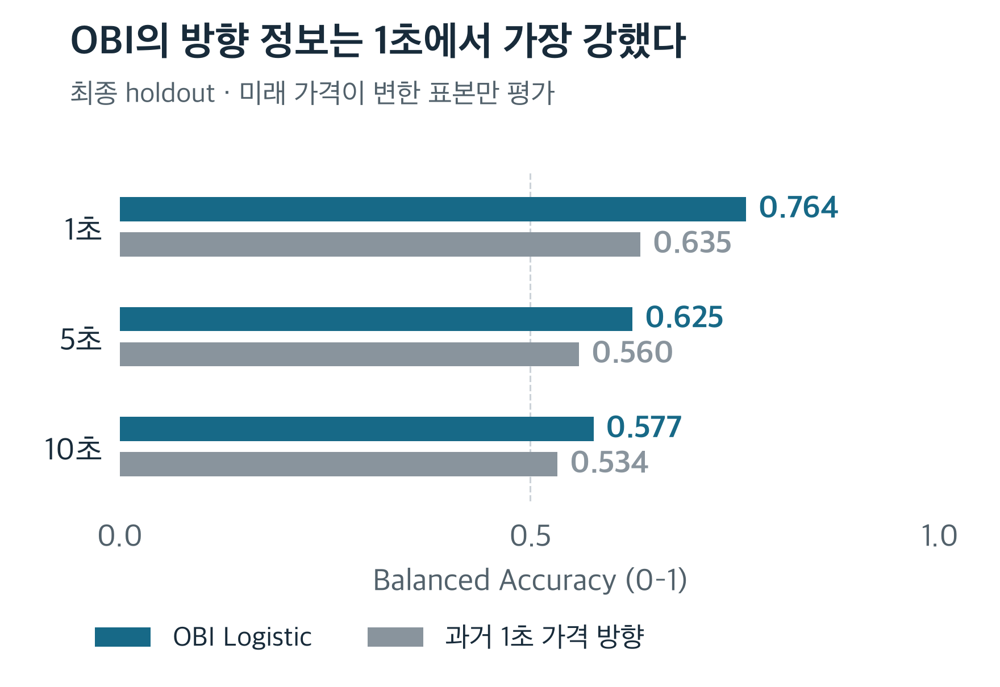

# Order Book Imbalance

**호가 수량의 불균형은 몇 초 뒤 BTC 가격 방향에 정보를 주는가?**

682,024건의 BBO를 분석하고 Logistic Regression을 고정한 뒤 이후 구간에서 검증했습니다. 최종 결과는 **짧은 구간의 방향 정보와, 이를 거래 수익으로 해석할 수 없는 이유**를 함께 보여줍니다.



Balanced Accuracy는 상승·하락 재현율의 평균입니다. 두 모델은 각 구간에서 동일한 가격 변화 표본으로 평가했습니다. 점선 0.5는 상수 방향 모델의 BA입니다.

**발견** · OBI는 세 구간 모두 기준 모델보다 높았고, 1초 0.764에서 10초 0.577로 약해졌습니다.<br>
**해석의 경계** · 1초 유효 라벨의 40.5%는 무변화입니다. 위 점수는 이 표본을 제외한 방향 예측입니다.<br>
**거래의 경계** · 실제 체결·지연·수수료·slippage·PnL은 검증하지 않았습니다.

[결과 JSON](results/final_v1/primary_holdout.json) · [전체 보고서](research/final_v1/REPORT.md) · [한국어 상세 요약](research/final_v1/SUMMARY_KO.md)

---

## 이 결과를 믿기 전에 확인할 것

최종 구간은 **2026-10-08 15:15:56–17:15:56 UTC**, BBO 77,143건입니다. 1·5·10초의 방향 평가 표본은 4,184 / 6,464 / 6,760개입니다. 전체 archive는 Hyperliquid BTC perpetual의 28개 세션이지만 **UTC 날짜는 이틀**입니다.

1초에서 변화 표본의 방향 Accuracy는 0.767입니다. 무변화까지 포함한 7,034개에서 상승·하락을 강제 선택하면 전체 일치율은 0.456입니다. 평가 분모와 목표가 다르며 BA와 같은 지표가 아닙니다. 움직일 시점을 미리 골라내는 모델은 학습하지 않았습니다.

앞선 다음 날 세션보다 최종 성능이 낮아졌습니다. 표본 구성과 시장 상태가 달라 동일 조건의 반복 실험으로 볼 수 없습니다. 최종 구간도 이미 관측한 날짜의 뒤쪽이며 사용한 holdout을 다시 미사용 자료로 취급할 수 없습니다.

## 연구 설계의 핵심

- **입력:** 최우선 호가의 `OBI = (bid_size − ask_size) / (bid_size + ask_size)`. Spread·Microprice도 비교했지만 큰 일관된 개선은 없었습니다.
- **시점:** 수신 시각까지 들어온 마지막 호가만 사용합니다. 오래되거나 시각이 잘못된 관측을 제외하고 라벨이 세션·UTC 날짜를 넘지 않게 합니다.
- **분할:** 초기 60/20/20 시간순 분할에서 미래 라벨의 경계 침범을 제거합니다. 스케일러·분위수 경계는 학습 구간에서만 계산합니다.
- **고정:** 계수·전처리·0.5 임계값을 유지해 이후 구간을 평가합니다. protocol·모델·소스 해시를 기록하고 시간 블록으로 불확실성을 평가합니다.

[사전 protocol](research/final_v1/PROTOCOL.md) · [특징·시간 경계](src/obi_research/features.py) · [고정 모델 평가](research/oos.py) · [최종 분석](research/final_v1/run.py)

## 예측 이후의 질문은 보고서에 남겼습니다

| 더 확인할 질문 | 분석 위치 |
|---|---|
| OBI가 커질수록 가격 변화도 커지는가? | [구간별 관계·강건성](research/final_v1/REPORT.md#9-robustness-analysis) |
| 무변화와 이전 세션을 포함하면 결과가 달라지는가? | [전체 시점 결과](results/final_v1/exploration.json) |
| 스프레드와 평가 지연을 고려해도 유효한가? | [실행 가능성](research/final_v1/REPORT.md#10-execution-feasibility) |

학습 OBI 구간 평균으로 만든 별도 예측은 어느 구간에서도 개별 예측이 `spread + 1bps`를 넘지 않았습니다. 1bps는 가정한 추가 왕복 비용입니다. 스프레드 비교와 1초 늦춘 가격 평가도 실제 체결 실험은 아닙니다. 중첩 라벨·작은 초기 학습 표본·시각 품질에 따른 제외·고정 모델에 조건부인 신뢰구간이 해석을 제한합니다.

## 공개 결과 검산

Python 3.11+ · 원시 데이터와 API Key 없이 실행합니다.

```bash
git clone https://github.com/Min9s/orderbook-imbalance-research.git
cd orderbook-imbalance-research
python3 -m venv .venv
source .venv/bin/activate
python -m pip install -e '.[dev]'
python -m pytest -q
python examples/verify_public_results.py
python -m pip check
```

33개 공개 테스트와 검산 스크립트는 계산·시간 조건·혼동행렬·기록된 해시의 일관성을 확인합니다. 전체 가격 경로·ROC-AUC·신뢰구간 재구성에는 비공개 archive가 필요합니다. 그림은 `python assets/readme/editorial.py`로 재생성합니다 (Matplotlib·한국어 글꼴 필요).

[데이터 접근](research/final_v1/DATA_ACCESS.md) · [재현 기록](research/final_v1/VERIFICATION.md) · [공개 범위](PUBLICATION.md) · [출처·AI 보조 사용](PROVENANCE.md). 별도 open-source LICENSE나 원시 데이터 재배포 권한을 주장하지 않습니다.
