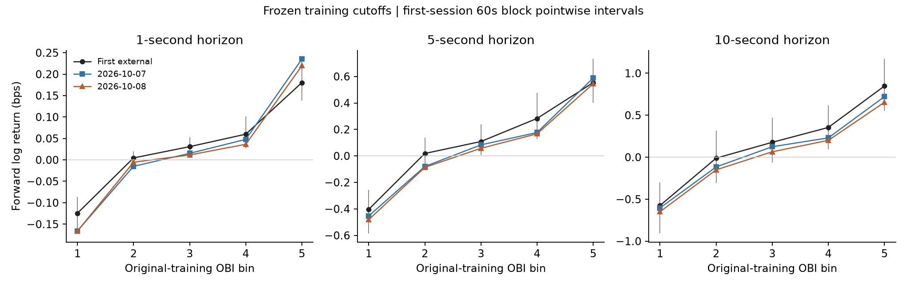
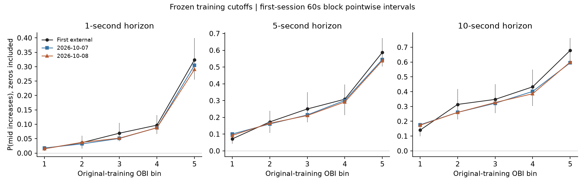

# Frozen-model independent-session validation

**Result:** the positive OBI relationship reproduced in the predesignated next-day session, with no external retraining or threshold selection. This is evidence from one new date, not multiple independent days. All numbers are conditional on the existing admission rules and (for classification) future nonzero returns.

## Freeze and temporal separation

[EXTERNAL_PROTOCOL.md](EXTERNAL_PROTOCOL.md) and `results/oos/protocol.json` were recorded before external predictions. Frozen coefficients/scalers/quantile edges are in `results/oos/frozen_models.json`. The original101/391/641 training observations recreate original test predictions before new evaluation. No external observation reaches fit(). The entire original session ended2026-10-07 07:44:11 UTC; the first external begins2026-10-08 01:56:14 UTC, with no timestamp or event-ID overlap. Its preceding selection used quality only. Local provenance records are not independent exchange signatures.

External session `95a74716c1c140eb8e896cb11f924151`: 16,945 raw BBO,43.6minutes,2,616 one-second states,2,614 usable states. All eligible times are evaluated; there is no new internal train/test split. Original pilot test was only the final20% of its42-minute interval.

| Horizon | Forward labels | Up | Down | Unchanged | Direction N | Original test N |
|---|---:|---:|---:|---:|---:|---:|
| 1s | 2,612 | 258 (9.9%) | 180 (6.9%) | 2174 (83.2%) | 438 | 56 |
| 5s | 2,604 | 645 (24.8%) | 547 (21.0%) | 1412 (54.2%) | 1,192 | 187 |
| 10s | 2,594 | 900 (34.7%) | 808 (31.1%) | 886 (34.2%) | 1,708 | 301 |

The1-second count rose from56 to438 partly because43.6minutes are evaluated rather than about8.5minutes, and partly because the nonzero rate is16.8% versus10.9% in the original test. Neither438 overlapping/state-dependent labels nor44 one-minute blocks represent438 independent market episodes. Zero exclusion is outcome-conditioned; these are not unconditional next-second trading scores.

## All fixed models

Entries show point estimate and60s paired clock-block pointwise95% CI. Confusion matrices: rows=true down/up; columns=predicted down/up. AUC has no CI here and is null without both classes.

| Horizon | Model | N | Accuracy [CI] | Balanced Accuracy [CI] | AUC | Confusion matrix |
|---|---|---:|---|---|---:|---|
| 1s | Training majority | 438 | 0.589 [0.504, 0.672] | 0.500 [0.500, 0.500] | 0.500 | `[[0, 180], [0, 258]]` |
| 1s | Past-price rule | 438 | 0.678 [0.595, 0.749] | 0.616 [0.586, 0.645] | 0.759 | `[[48, 132], [9, 249]]` |
| 1s | OBI | 438 | 0.904 [0.872, 0.935] | 0.909 [0.879, 0.938] | 0.961 | `[[169, 11], [31, 227]]` |
| 1s | OBI + spread + microprice | 438 | 0.904 [0.872, 0.935] | 0.909 [0.879, 0.938] | 0.953 | `[[169, 11], [31, 227]]` |
| 5s | Training majority | 1192 | 0.541 [0.458, 0.623] | 0.500 [0.500, 0.500] | 0.500 | `[[0, 547], [0, 645]]` |
| 5s | Past-price rule | 1192 | 0.598 [0.527, 0.666] | 0.565 [0.545, 0.582] | 0.652 | `[[91, 456], [23, 622]]` |
| 5s | OBI | 1192 | 0.799 [0.757, 0.838] | 0.800 [0.758, 0.837] | 0.871 | `[[444, 103], [137, 508]]` |
| 5s | OBI + spread + microprice | 1192 | 0.798 [0.757, 0.836] | 0.799 [0.757, 0.836] | 0.869 | `[[444, 103], [138, 507]]` |
| 10s | Training majority | 1708 | 0.527 [0.446, 0.606] | 0.500 [0.500, 0.500] | 0.500 | `[[0, 808], [0, 900]]` |
| 10s | Past-price rule | 1708 | 0.567 [0.495, 0.637] | 0.544 [0.529, 0.559] | 0.604 | `[[103, 705], [35, 865]]` |
| 10s | OBI | 1708 | 0.725 [0.680, 0.767] | 0.726 [0.680, 0.767] | 0.798 | `[[598, 210], [259, 641]]` |
| 10s | OBI + spread + microprice | 1708 | 0.725 [0.680, 0.767] | 0.726 [0.680, 0.767] | 0.797 | `[[598, 210], [259, 641]]` |

| Horizon | OBI−majority Accuracy CI | OBI−price-rule Accuracy CI | OBI−majority BA CI | OBI−price-rule BA CI |
|---|---|---|---|---|
| 1s | [0.232, 0.406] | [0.153, 0.307] | [0.379, 0.438] | [0.259, 0.330] |
| 5s | [0.173, 0.348] | [0.127, 0.275] | [0.258, 0.337] | [0.198, 0.270] |
| 10s | [0.114, 0.287] | [0.085, 0.237] | [0.180, 0.267] | [0.140, 0.223] |

These intervals favor OBI in this candidate under the registered block assumptions. They condition on the fitted original model and this session, omit between-day/training-estimation uncertainty, and do not establish universal superiority. Combined-feature performance is nearly identical or slightly worse; microprice is a deterministic OBI×spread interaction.

## Returns, quantiles and horizon

| Horizon | OBI/return correlation [60s CI] | Lowest/highest-bin mean return bps | Lowest/highest-bin P(up) | Nondecreasing bin means? |
|---|---|---|---|---|
| 1s | 0.305 [0.275, 0.337] | -0.124 / 0.180 | 1.5% / 32.4% | True |
| 5s | 0.376 [0.328, 0.427] | -0.404 / 0.553 | 7.1% / 58.7% | True |
| 10s | 0.356 [0.290, 0.423] | -0.575 / 0.848 | 14.0% / 67.9% | True |

All bin cutoffs come from original training, not the external distribution; bin counts need not be equal. Probabilities include unchanged returns. Direction-model BA decreases with horizon, while unconditional correlation rises from1s to5s and then falls at10s. A blanket statement that every predictive relationship decays monotonically is unsupported.

## Block sensitivity

44 one-minute blocks support each horizon (35/37/37 contain both directional classes). This is more than the original test9 blocks, but not independent dates. The following intervals report every registered length/alignment rather than selecting a favorable setting.

| Horizon | Block / offset | Blocks | OBI BA CI | OBI−price BA CI |
|---|---|---:|---|---|
| 1s | 30s_offset0 | 88 | [0.879, 0.939] | [0.259, 0.330] |
| 1s | 30s_offset15 | 88 | [0.877, 0.938] | [0.259, 0.338] |
| 1s | 60s_offset0 | 44 | [0.879, 0.938] | [0.259, 0.330] |
| 1s | 60s_offset30 | 45 | [0.878, 0.936] | [0.256, 0.331] |
| 1s | 120s_offset0 | 22 | [0.873, 0.945] | [0.250, 0.341] |
| 1s | 120s_offset60 | 23 | [0.875, 0.941] | [0.250, 0.348] |
| 5s | 30s_offset0 | 88 | [0.755, 0.842] | [0.197, 0.273] |
| 5s | 30s_offset15 | 88 | [0.750, 0.844] | [0.192, 0.277] |
| 5s | 60s_offset0 | 44 | [0.758, 0.837] | [0.198, 0.270] |
| 5s | 60s_offset30 | 45 | [0.751, 0.840] | [0.194, 0.269] |
| 5s | 120s_offset0 | 22 | [0.758, 0.836] | [0.197, 0.271] |
| 5s | 120s_offset60 | 23 | [0.758, 0.837] | [0.195, 0.275] |
| 10s | 30s_offset0 | 87 | [0.680, 0.767] | [0.139, 0.220] |
| 10s | 30s_offset15 | 88 | [0.676, 0.776] | [0.134, 0.226] |
| 10s | 60s_offset0 | 44 | [0.680, 0.767] | [0.140, 0.223] |
| 10s | 60s_offset30 | 44 | [0.677, 0.764] | [0.141, 0.220] |
| 10s | 120s_offset0 | 22 | [0.682, 0.763] | [0.141, 0.217] |
| 10s | 120s_offset60 | 23 | [0.689, 0.762] | [0.143, 0.221] |

Full metrics, class coverage, bin counts and uncertainty diagnostics: [first_external.json](../results/oos/first_external.json). Per-observation prediction CSVs are local under ignored `data/`, not bundled raw data. Reproduction commands are in the README; the first external stage never calls fit(). The final reserved session remains unevaluated.
