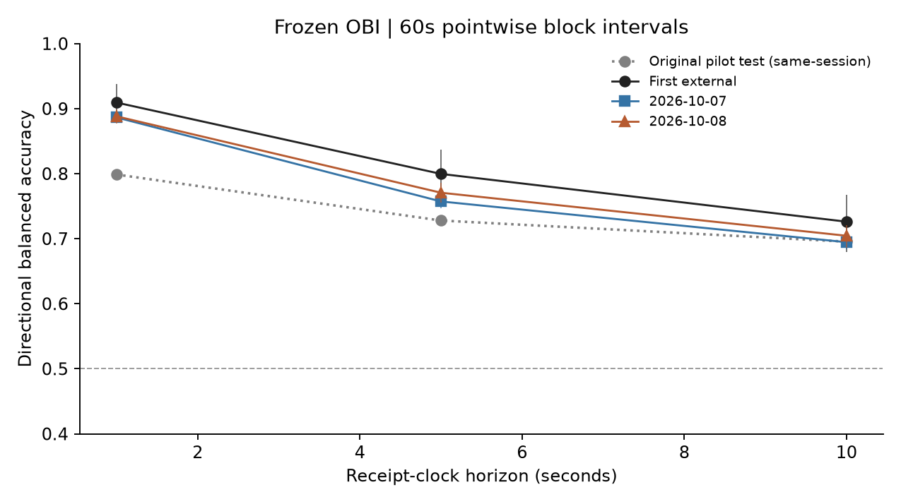
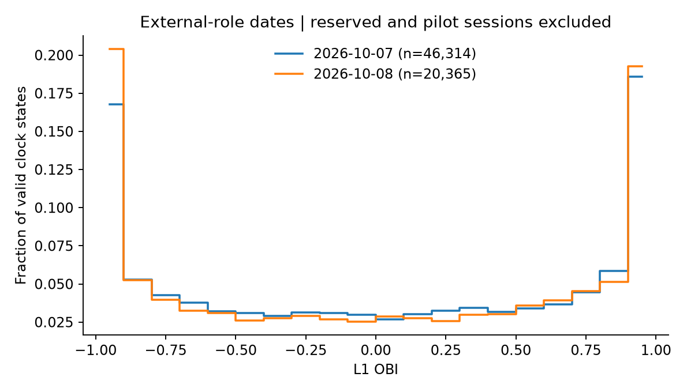
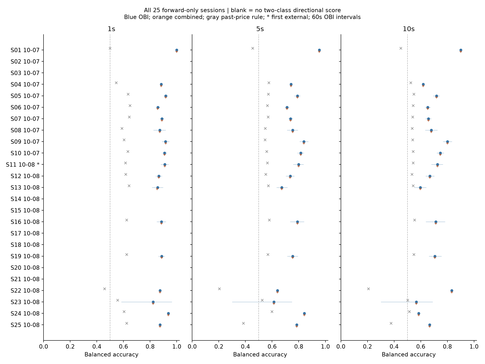

# Fixed-model date and session robustness

The archive contains **two UTC dates, not28 independent trading days**. Oct7 includes the original training date; Oct8 is the only new date. All25 forward-only sessions plus1 pre-training diagnostic are disclosed. The latter was discovered in a post-protocol temporal-role audit; the registered26-session aggregate is preserved separately. The full original session(55,310 rows) and latest reserved session(77,143 rows) are excluded. No concatenation, cross-session labels, cross-date labels, interpolation, re-fit or favorable-session selection was performed. See [the transparent protocol addendum](EXTERNAL_PROTOCOL_ADDENDUM.md) for the chronological correction. First-external observations are included once in these broader date summaries, so those summaries are not additional independent replications of the first result.

## Date-level results

| UTC date | Horizon | Labels | Up / Down / Zero | Direction N | Majority BA | Price-rule BA | OBI BA [60s CI] | Combined BA | OBI/return correlation |
|---|---|---:|---|---:|---:|---:|---|---:|---:|
| 2026-10-07 | 1s | 46,238 | 4,448 / 4,236 / 37,554 | 8,684 | 0.500 | 0.638 | 0.887 [0.878, 0.895] | 0.887 | 0.324 |
| 2026-10-07 | 5s | 45,938 | 11,449 / 11,199 / 23,290 | 22,648 | 0.500 | 0.566 | 0.757 [0.746, 0.768] | 0.757 | 0.325 |
| 2026-10-07 | 10s | 45,581 | 15,198 / 15,179 / 15,204 | 30,377 | 0.500 | 0.543 | 0.695 [0.683, 0.706] | 0.695 | 0.281 |
| 2026-10-08 | 1s | 19,756 | 1,847 / 1,877 / 16,032 | 3,724 | 0.500 | 0.628 | 0.888 [0.877, 0.899] | 0.888 | 0.318 |
| 2026-10-08 | 5s | 18,687 | 4,560 / 4,961 / 9,166 | 9,521 | 0.500 | 0.565 | 0.771 [0.755, 0.786] | 0.770 | 0.340 |
| 2026-10-08 | 10s | 18,162 | 6,024 / 6,641 / 5,497 | 12,665 | 0.500 | 0.545 | 0.705 [0.686, 0.721] | 0.704 | 0.303 |

Daily CIs resample clock blocks separately within each observed session-date and preserve session composition. They are **not** intervals for performance on a random new trading day. There is no date bootstrap: two dates, only one new date, are insufficient for a credible between-day distribution.

## OBI distributions

| Date | Valid feature-grid states | OBI min / p10 / median / p90 / max |
|---|---:|---|
| 2026-10-07 | 46,314 | -1.000 / -0.981 / 0.057 / 0.986 / 1.000 |
| 2026-10-08 | 20,365 | -1.000 / -0.997 / 0.023 / 0.989 / 1.000 |

## Every forward-only session

Blank/undefined BA means there are no two-class directional observations, not poor results removed from the report. Session IDs map directly to chronological S-labels in the figure. Short-session scores with both classes but very few labels are descriptive; CIs are null with fewer than4 time blocks.

| S | Session ID | Date(s) | Raw rows | 1s direction N / BA | 5s direction N / BA | 10s direction N / BA |
|---|---|---|---:|---|---|---|
| S01 | `61ad52b42c094b1dafbc9fc5c1e29102` | 2026-10-07 | 711 | 7 / 1.000 | 14 / 0.955 | 12 / 0.900 |
| S02 | `a0460445c46d4fa0885ef42cfc842006` | 2026-10-07 | 122 | 1 / undefined | 2 / undefined | 2 / undefined |
| S03 | `e092d868777d4b77bbb9aaa9838bce63` | 2026-10-07 | 63 | 1 / undefined | 2 / undefined | 0 / undefined |
| S04 | `6d21d8afdf8b4d5290ba079778895b88` | 2026-10-07 | 1,254 | 25 / 0.883 | 70 / 0.742 | 96 / 0.618 |
| S05 | `bf0a38528fe54bd9953042336d082753` | 2026-10-07 | 80,587 | 1740 / 0.917 | 5003 / 0.790 | 6976 / 0.719 |
| S06 | `e25bf6d83b7045eb84fba4f1876b8e89` | 2026-10-07 | 90,157 | 3016 / 0.858 | 6894 / 0.711 | 8648 / 0.653 |
| S07 | `1f8bc06730564ab0ab8ae4e5ba6daa51` | 2026-10-07 | 88,121 | 2699 / 0.889 | 6767 / 0.739 | 8661 / 0.657 |
| S08 | `fa8185efa43e4b6daae26552be8930c0` | 2026-10-07 | 66,386 | 323 / 0.872 | 854 / 0.755 | 1129 / 0.679 |
| S09 | `8d46cf66bef94c26bdd9a6b666e00394` | 2026-10-07 | 48,403 | 630 / 0.916 | 2216 / 0.839 | 3536 / 0.800 |
| S10 | `00a32f7bcd4e421a8540d5cbd0fdabe7` | 2026-10-07, 2026-10-08 | 60,896 | 1247 / 0.909 | 3838 / 0.815 | 5684 / 0.747 |
| S11 | `95a74716c1c140eb8e896cb11f924151` | 2026-10-08 | 16,945 | 438 / 0.909 | 1192 / 0.800 | 1708 / 0.726 |
| S12 | `f84a23a19e4640afaea55db02b298d96` | 2026-10-08 | 23,789 | 674 / 0.866 | 1802 / 0.736 | 2348 / 0.669 |
| S13 | `f6411dec62e64c7bbafad54f92756460` | 2026-10-08 | 9,633 | 361 / 0.856 | 825 / 0.672 | 939 / 0.598 |
| S14 | `c666f085288a4b6d97852a41605383c5` | 2026-10-08 | 47 | 1 / undefined | 0 / undefined | 0 / undefined |
| S15 | `3f2232407e7e4c629486bd1f1142d562` | 2026-10-08 | 15 | 0 / undefined | 0 / undefined | 0 / undefined |
| S16 | `30c11f8b470f4025ab29efa373c45090` | 2026-10-08 | 15,062 | 345 / 0.885 | 1055 / 0.790 | 1484 / 0.714 |
| S17 | `d71a6296b750428c928b1db3ff980339` | 2026-10-08 | 31 | 0 / undefined | 0 / undefined | 0 / undefined |
| S18 | `132178fdc51c4501b24acea81871fa5a` | 2026-10-08 | 36 | 2 / undefined | 0 / undefined | 0 / undefined |
| S19 | `d5e4f076679b46be98947996d5397589` | 2026-10-08 | 40,931 | 833 / 0.887 | 1495 / 0.755 | 1681 / 0.707 |
| S20 | `aba1fc356d75465088617f88c5016c89` | 2026-10-08 | 271 | 3 / undefined | 4 / undefined | 0 / undefined |
| S21 | `bf87b53c4aab4739aae7c6a2db1a5860` | 2026-10-08 | 1,358 | 4 / undefined | 8 / undefined | 6 / undefined |
| S22 | `1b1961b8bc54492a962972f0d38adc35` | 2026-10-08 | 274 | 7 / 0.875 | 16 / 0.641 | 15 / 0.833 |
| S23 | `de574dbd54dc4bc9bed8d45e02779b19` | 2026-10-08 | 3,506 | 30 / 0.823 | 68 / 0.613 | 71 / 0.567 |
| S24 | `f2e394cfb3cc4baba411ada736c6e338` | 2026-10-08 | 373 | 11 / 0.938 | 27 / 0.842 | 27 / 0.585 |
| S25 | `0f972725979643149fcacf1c203cedb4` | 2026-10-08 | 275 | 10 / 0.875 | 17 / 0.786 | 19 / 0.667 |

The pre-training44-second session `f1d0c0b3bd1f4c7b844074508477be4c` is retained as a retrospective diagnostic only:1/5/10s directional N=7/17/22, OBI BA=1.000/0.694/0.637. It is excluded from the figures and date/pooled forward-only estimates; its rows remain in the metrics CSV with an explicit diagnostic role.

All four models, Accuracy, BA, ROC-AUC, matrices, class counts and60s BA intervals appear in [session_model_metrics.csv](../results/oos/session_model_metrics.csv); date equivalents are in [date_model_metrics.csv](../results/oos/date_model_metrics.csv). The pooled result weights observations, whereas session/date tables expose heterogeneity. No equal-day generalization is inferred from the pooled number.

## Pooled external-role evidence

| Horizon | Labels | Direction N | OBI BA [60s CI] | OBI−majority BA CI | OBI−price BA CI | Correlation [60s CI] | Monotone quantile means? |
|---|---:|---:|---|---|---|---|---|
| 1s | 65,994 | 12,408 | 0.887 [0.881, 0.894] | [0.381, 0.394] | [0.244, 0.260] | 0.322 [0.314, 0.331] | True |
| 5s | 64,625 | 32,169 | 0.761 [0.753, 0.769] | [0.253, 0.269] | [0.188, 0.205] | 0.330 [0.316, 0.344] | True |
| 10s | 63,743 | 43,042 | 0.698 [0.688, 0.708] | [0.188, 0.208] | [0.145, 0.163] | 0.287 [0.272, 0.304] | True |

Block lengths30/60/120s and half-block offsets are all recorded in robustness.json for pooled/date results. Their CIs remain conditional on fixed sessions and do not include training-estimation/model-selection/multiple-comparison uncertainty. Labels overlap for5s/10s; even1s non-overlapping returns can share persistent OBI/market regimes. Many clock blocks are more information than9 blocks, but not more independent trading dates.

## Causal market-state diagnostics

Low/high thresholds are the original training medians. Volatility is trailing60-second RMS past1-second log returns in bps, requiring60 valid increments; it is neither forward/realized target volatility nor an annualized estimate. Unknown windows are reported. No regime threshold was fitted on new outcomes. These strata differ in session/class composition and do not identify a causal regime effect.

| Horizon | Variable | Fixed cutoff | Regime | Labels | Direction N | Price BA | OBI BA | Combined BA |
|---|---|---:|---|---:|---:|---:|---:|---:|
| 1s | spread_bps | 0.11877 | low | 51 | 9 | 0.500 | 1.000 | 1.000 |
| 1s | spread_bps | 0.11877 | high | 65,943 | 12,399 | 0.635 | 0.887 | 0.887 |
| 1s | spread_bps | 0.11877 | unknown | 0 | 0 | undefined | undefined | undefined |
| 1s | lag_seconds | 0.253345 | low | 53,892 | 8,987 | 0.629 | 0.891 | 0.892 |
| 1s | lag_seconds | 0.253345 | high | 12,102 | 3,421 | 0.651 | 0.876 | 0.875 |
| 1s | lag_seconds | 0.253345 | unknown | 0 | 0 | undefined | undefined | undefined |
| 1s | past_vol_bps | 0.200236 | low | 11,029 | 933 | 0.596 | 0.940 | 0.940 |
| 1s | past_vol_bps | 0.200236 | high | 47,986 | 10,289 | 0.641 | 0.882 | 0.882 |
| 1s | past_vol_bps | 0.200236 | unknown | 6,979 | 1,186 | 0.612 | 0.891 | 0.891 |
| 5s | spread_bps | 0.11877 | low | 35 | 18 | 0.462 | 0.962 | 0.962 |
| 5s | spread_bps | 0.11877 | high | 64,590 | 32,151 | 0.565 | 0.761 | 0.761 |
| 5s | spread_bps | 0.11877 | unknown | 0 | 0 | undefined | undefined | undefined |
| 5s | lag_seconds | 0.253148 | low | 52,634 | 25,265 | 0.561 | 0.761 | 0.761 |
| 5s | lag_seconds | 0.253148 | high | 11,991 | 6,904 | 0.581 | 0.762 | 0.762 |
| 5s | lag_seconds | 0.253148 | unknown | 0 | 0 | undefined | undefined | undefined |
| 5s | past_vol_bps | 0.200236 | low | 10,875 | 3,134 | 0.548 | 0.845 | 0.845 |
| 5s | past_vol_bps | 0.200236 | high | 47,849 | 26,663 | 0.568 | 0.750 | 0.750 |
| 5s | past_vol_bps | 0.200236 | unknown | 5,901 | 2,372 | 0.558 | 0.774 | 0.774 |
| 10s | spread_bps | 0.118768 | low | 21 | 14 | 0.458 | 0.917 | 0.917 |
| 10s | spread_bps | 0.118768 | high | 63,722 | 43,028 | 0.543 | 0.698 | 0.698 |
| 10s | spread_bps | 0.118768 | unknown | 0 | 0 | undefined | undefined | undefined |
| 10s | lag_seconds | 0.253215 | low | 51,884 | 34,359 | 0.541 | 0.698 | 0.698 |
| 10s | lag_seconds | 0.253215 | high | 11,859 | 8,683 | 0.554 | 0.697 | 0.697 |
| 10s | lag_seconds | 0.253215 | unknown | 0 | 0 | undefined | undefined | undefined |
| 10s | past_vol_bps | 0.200236 | low | 10,697 | 4,813 | 0.536 | 0.779 | 0.779 |
| 10s | past_vol_bps | 0.200236 | high | 47,670 | 35,319 | 0.545 | 0.685 | 0.685 |
| 10s | past_vol_bps | 0.200236 | unknown | 5,376 | 2,910 | 0.538 | 0.719 | 0.719 |

## Registered sampling/admission sensitivity

Primary conditions remain receipt TTL2s and exchange-to-receipt lag[0,2]s on a1s grid. The diagnostics tighten TTL to1s, tighten lag to<=0.5s, or keep every other decision start while retaining exact1/5/10s endpoints from the1s price grid. They do not select a winning variant. Different retention changes the cohort, so score differences are not pure causal latency effects.

| Condition | Horizon | Labels | Direction N | OBI BA | Price-rule BA |
|---|---|---:|---:|---:|---:|
| primary | 1s | 65,994 | 12,408 | 0.887 | 0.635 |
| primary | 5s | 64,625 | 32,169 | 0.761 | 0.565 |
| primary | 10s | 63,743 | 43,042 | 0.698 | 0.543 |
| ttl1s | 1s | 64,677 | 12,361 | 0.887 | 0.635 |
| ttl1s | 5s | 61,199 | 31,542 | 0.759 | 0.566 |
| ttl1s | 10s | 58,101 | 40,910 | 0.693 | 0.544 |
| lag500ms | 1s | 64,862 | 11,971 | 0.889 | 0.633 |
| lag500ms | 5s | 61,690 | 30,257 | 0.766 | 0.565 |
| lag500ms | 10s | 58,938 | 39,371 | 0.703 | 0.544 |
| decision_every2s | 1s | 33,006 | 6,165 | 0.890 | 0.635 |
| decision_every2s | 5s | 32,317 | 16,077 | 0.763 | 0.565 |
| decision_every2s | 10s | 31,879 | 21,550 | 0.698 | 0.545 |

## Observed heterogeneity and limitations

The next-day primary result is stronger than the original pilot, while date-level OBI BA differs by roughly0.0–1.4percentage points across the onlytwo available dates. That is not a confidence interval for new-date stability. Session-level dispersion is wider and tiny cohorts can yield1.0 BA; all are disclosed. Across evaluable forward-only sessions the point-score comparison favors OBI, but sessions are neither independent days nor equally informative.

Causal past-volatility strata show lower OBI BA in the high-volatility group at all three horizons. This is a descriptive association, not proof that volatility causes predictability to decline. The original-training spread cutoff puts almost every new directional observation in the high group; the low group is too sparse for a meaningful spread-regime claim. The combined model provides no clear repeatable improvement. Lag-group differences are mixed across horizons. Tightening admission or halving decision frequency changes scores modestly, but also changes the admitted cohort and cannot identify a causal latency benefit.

## Scope of inference

- A positive OBI/forward-mid relationship and direction-model ranking are observed on the new date; numerical outcomes for every session are retained, including failures/undefined small samples.
- Direction BA generally decays over1→5→10s. Correlation and quantile mean-return magnitudes need not decay monotonically. Regime and date comparisons are descriptive and confounded by different admissible cohorts.
- Spread/microprice do not establish a repeatable incremental advantage; their mathematical dependence and original small training sample restrict interpretation.
- Negative exchange/receive differences invalidate67,059 archive rows; another6,036 exceed2s. This creates a clock/admission-selected sample. Clock differences are not pure measured network latency without trusted synchronization.
- Only one new date is tested. More ticks, sessions, blocks and narrow conditional CIs do not establish market-regime generalization. The latest session remains reserved; expanding to several independent dates is still needed.
- No executable profitability is established. Mid is not an execution price; spread/fees, queue position, latency, cancellation/fill probabilities and own-order impact can dominate sub-bps forecast returns. Queue/fill simulation, realized slippage and market impact were not measured.

Full chronological record: [chronological_robustness.json](../results/oos/chronological_robustness.json). The original registered all-role record remains [robustness.json](../results/oos/robustness.json). Raw BBO and per-event predictions are not redistributed. No collection, original-repository edits, commit or push was performed.
