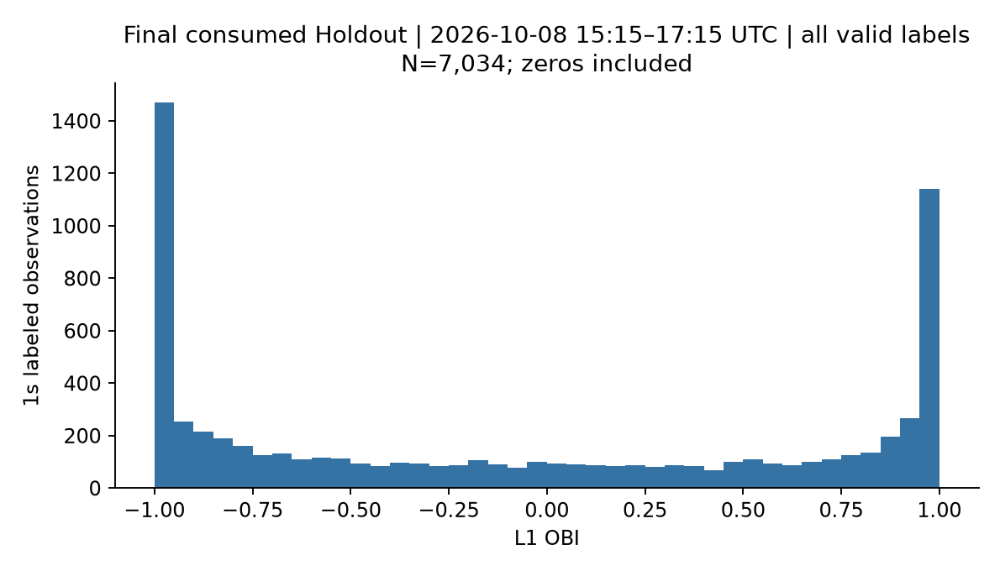
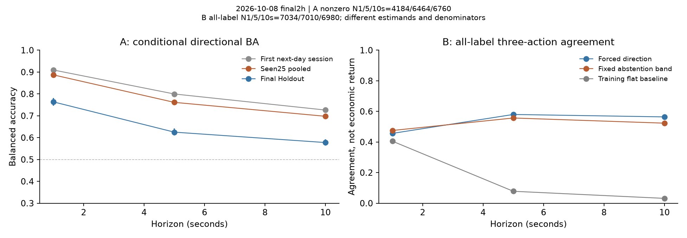
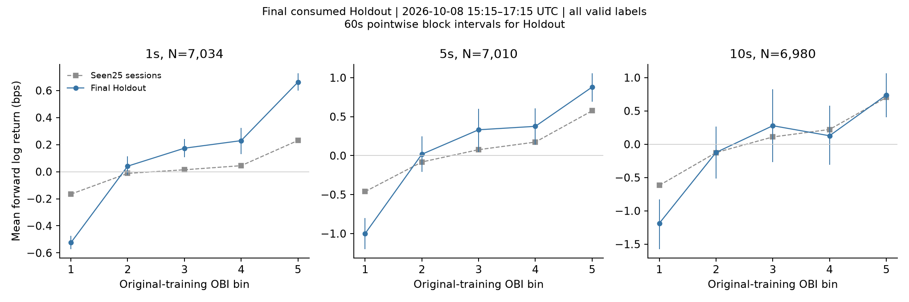
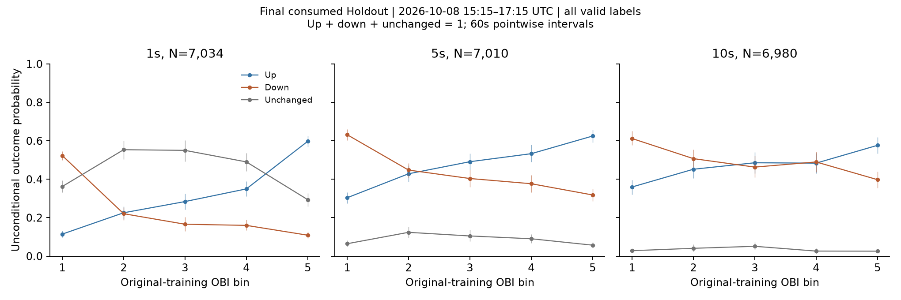
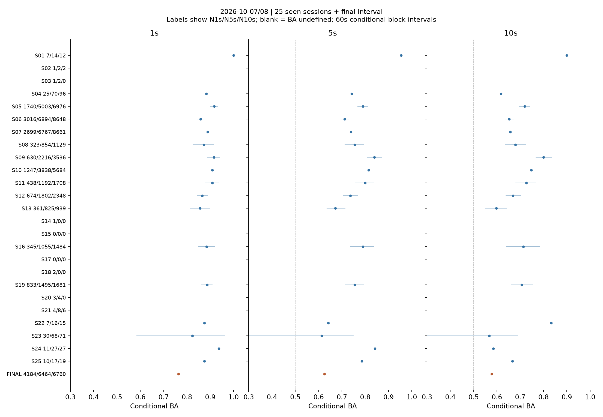
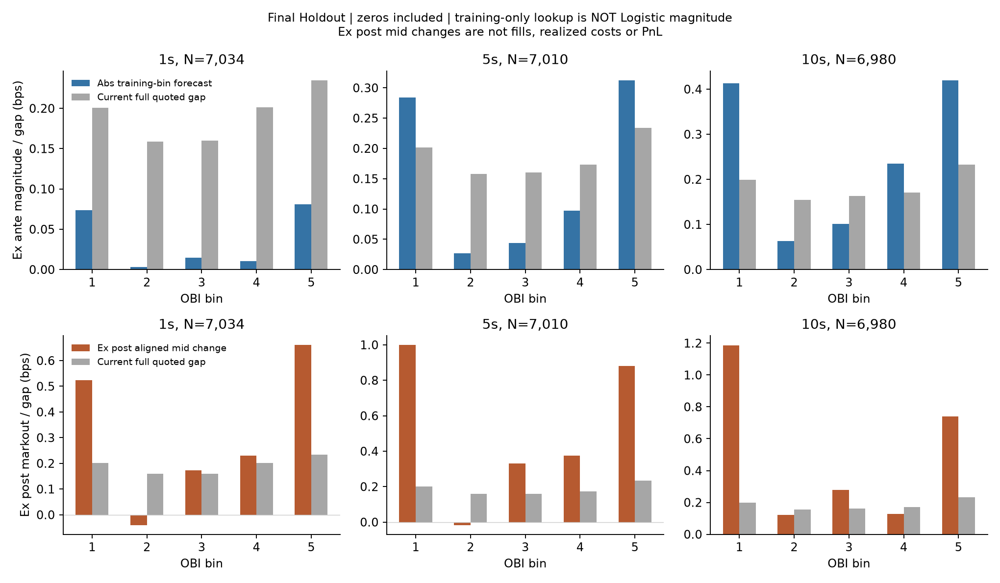
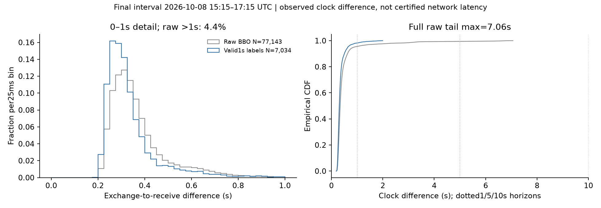

# Order Book Imbalance and Short-Horizon Price Predictability in BTC Markets

Final-v1 research report. BTC perpetual L1 BBO; Hyperliquid local observed archive; protocol recorded before final disclosure. All times UTC. Primary A and exploratory B are explicitly separate.

## 1. Abstract

We study whether best-level order-book imbalance(OBI) predicts1/5/10-second BTC mid-price movements using682,024 observed BBO updates across28 sessions but onlytwo UTC dates. Original-training Logistic models are frozen before scoring a final77,143-update interval. Conditional-on-move Balanced Accuracy declines to0.764/0.625/0.577 from0.909/0.800/0.726 in the earlier next-day session, while remaining above fixed baselines under within-session block uncertainty. Including unchanged outcomes yields different coverage and action-agreement results, and the conditional score is not an unconditional probability. Training-only OBI-bin expected moves and quoted-gap comparisons do not establish executable profitability; a predeclared1-second deferred markout sensitivity further weakens direction discrimination. The final interval is now consumed, and the two-date archive cannot support broad independent-day generalization.

## 2. Introduction

Displayed liquidity can contain short-horizon information, yet a directional relationship is not equivalent to a deployable trading rule. This compact study reuses Liquidation Gravity's existing quote metric, avoids new collection/execution infrastructure, and emphasizes available-at-decision information, fixed estimation, temporal validation and honest market-state dependence. BBO provides prices and displayed sizes at the best levels, not individual orders or fills. This report distinguishes predictable quote revisions from achievable net trading returns.

## 3. Research Hypothesis

A asks whether OBI predicts sign(r) given r!=0. Its primary endpoint is1s frozen OBI Balanced Accuracy and paired gain against the original training-majority baseline; other horizons/models are secondary. B asks whether OBI contains useful information over **all** admissible observation times, including r=0. B is assessed through unconditional bin means/outcome probabilities, score ranking, coverage and fixed-action diagnostics. It is not substituted for A.

Formally, `p_A(x)=P(r>0 | r!=0,x)`, whereas `P(r>0 | x)=P(r!=0 | x) p_A(x)`. The original binary model does not estimate the first factor. A high conditional accuracy therefore neither identifies when a price will move nor supplies a calibrated all-time probability. A constant-flat classifier can have high raw agreement in a quiet market without contradicting positive OBI information in conditional means.

## 4. Dataset and Data Quality

The existing archive contains682,024 BBO across28 session IDs on2026-10-07/08, not28 independent days. One session crosses midnight. Numeric bid/ask prices and sizes are complete and positive, with no crossed quotes, but67,059 rows have negative exchange–receive differences and6,036 exceed2s. The earlier audit found5 adjacent exchange timestamp reversals. These clock differences are not corrected to gain samples. Sessions are not joined or interpolated.

The original42-minute pilot uses15,295 quotes. Its entire55,310-row session is excluded from chronological external aggregates; a325-row pre-training interval is preserved as retrospective only. The25 prior chronological sessions contain549,246 quotes. Final validation uses the last77,143 quotes,2026-10-08 15:15:56.594595–17:15:56.455088 UTC. It is later in time but on the **same already observed Oct8 date**, not a third day. Prior final-source/quality inspection did not inspect returns or model scores.

Final quality:7,200 clock states,7,041 valid states(97.79% feature coverage),1,841 raw clock differences>2s and no receive gaps>2s. Invalid-lag observations, rather than long receive gaps alone, can make a grid state unavailable. Independent UTC/monotonic clock evidence and loss-free feed coverage are not established. Raw redistribution rights and an exact public historical-download URL were not verified, so raw/event-level predictions remain unbundled.

## 5. Feature Construction

For best bid b, ask a and displayed quantities qb,qa: `mid=(b+a)/2`, `spread=a-b`, `relative_spread=spread/mid`, `OBI=(qb-qa)/(qb+qa)`, and `microprice=(a*qb+b*qa)/(qb+qa)`. Spread and microprice offsets are expressed in basis points. The identity `microprice_offset_bps=OBI*spread_bps/2` makes the added feature an interaction of the same L1 inputs, not independent data. Liquidation exposure, trade volume and synthetic OMS orders are not used.

At clock time t, the feature uses the latest BBO with receive time<=t. Both sizes must be>0, prices finite and0<b<=a, exchange-to-receive difference in[0,2]s, and receipt age<=2s. Invalid latest states do not revive older valid quotes. Forward return is `r(t,h)=log(M(t+h)/M(t))`, using the same receive-as-of rule at the exact endpoint. Every grid state through the label path must be valid, and labels cannot cross sessions or UTC dates. Clock-time seconds are not event counts.

## 6. Experimental Design

Original60/20/20 elapsed-time splits use strict purging: training label endpoints precede validation, and validation endpoints precede test. Training nonzero counts are101/391/641 at1/5/10s. The saved training-only scalers, coefficients and feature order reproduce original predictions and remain unchanged(C=1,lbfgs,max_iter2000,threshold0.5). Baselines are a constant original-training up prior and the sign of the previous1s return, with zero/missing history falling back to that prior. No Holdout fitting or selection occurs; runtime fit calls are disabled.

[Final protocol](PROTOCOL.md) records Primary A, exploratory rules, model/source fingerprints and training-only magnitude lookup before disclosure. The consumption ledger is written before labeling, and the resulting score is permanently seen. Replay checks the same calculation; it cannot restore an unused test. The earlier temporal-role correction is disclosed separately and original result files remain unchanged.

Primary uncertainty uses paired nonoverlapping30/60/120-second clock blocks and origin/half-block alignment,1,000 replicates;60s intervals are displayed. Empty blocks remain, blocks do not bridge session/date boundaries, and models are compared on identical rows. These are pointwise intervals conditional on fixed models and the observed session composition; no date bootstrap, training-estimation uncertainty, or multiplicity-adjusted generalization claim is made.

Exploratory B uses forced direction(p>=0.5), a fixed action band(up if p>0.6,down if p<0.4,else abstain), and the all-label original-training majority class(flat at each horizon). Coding abstention as0 permits descriptive three-action agreement/macro recall; it is not a fitted flat-price probability or economic utility. All-time up-vs-not-up AUC uses p only as a rank score, not calibrated probability. Five training-only bin means estimate magnitude separately from Logistic.

## 7. Predictive Performance

### Primary A: original target, final interval

| h | Valid labels | Up / down / unchanged | Nonzero fraction | Label coverage |
|---|---:|---|---:|---:|
| 1s | 7,034 | 1,975 / 2,209 / 2,850 | 59.5% | 97.7% |
| 5s | 7,010 | 3,060 / 3,404 / 546 | 92.2% | 97.4% |
| 10s | 6,980 | 3,132 / 3,628 / 220 | 96.8% | 97.1% |

Label coverage uses possible in-session grid pairs; the nonzero fraction is retrospective outcome coverage. It is not a deployable trigger.

| h | Frozen model | Direction N | Accuracy | Balanced Accuracy [60s95% CI] | AUC(point) | Confusion matrix |
|---|---|---:|---:|---|---:|---|
| 1s | Training up-prior | 4,184 | 0.472 | 0.500 [0.500, 0.500] | 0.500 | `[[0, 2209], [0, 1975]]` |
| 1s | Past1s price rule | 4,184 | 0.626 | 0.635 [0.619, 0.650] | 0.673 | `[[1069, 1140], [424, 1551]]` |
| 1s | OBI Logistic | 4,184 | 0.767 | 0.764 [0.746, 0.781] | 0.841 | `[[1823, 386], [589, 1386]]` |
| 1s | Combined Logistic | 4,184 | 0.767 | 0.764 [0.746, 0.782] | 0.828 | `[[1828, 381], [593, 1382]]` |
| 5s | Training up-prior | 6,464 | 0.473 | 0.500 [0.500, 0.500] | 0.500 | `[[0, 3404], [0, 3060]]` |
| 5s | Past1s price rule | 6,464 | 0.550 | 0.560 [0.547, 0.572] | 0.590 | `[[1289, 2115], [792, 2268]]` |
| 5s | OBI Logistic | 6,464 | 0.629 | 0.625 [0.609, 0.641] | 0.673 | `[[2372, 1032], [1367, 1693]]` |
| 5s | Combined Logistic | 6,464 | 0.629 | 0.625 [0.610, 0.642] | 0.666 | `[[2373, 1031], [1367, 1693]]` |
| 10s | Training up-prior | 6,760 | 0.463 | 0.500 [0.500, 0.500] | 0.500 | `[[0, 3628], [0, 3132]]` |
| 10s | Past1s price rule | 6,760 | 0.520 | 0.534 [0.518, 0.548] | 0.554 | `[[1252, 2376], [870, 2262]]` |
| 10s | OBI Logistic | 6,760 | 0.582 | 0.577 [0.563, 0.592] | 0.611 | `[[2339, 1289], [1534, 1598]]` |
| 10s | Combined Logistic | 6,760 | 0.582 | 0.577 [0.562, 0.592] | 0.605 | `[[2339, 1289], [1537, 1595]]` |

Matrices have rows=true down/up and columns=predicted down/up. Constant training majority remains upward even though final nonzero observations are slightly downward-skewed; it is not reselected using test labels.

| h | OBI−majority Accuracy CI | OBI−price-rule Accuracy CI | OBI−price-rule BA CI |
|---|---|---|---|
| 1s | [0.266, 0.328] | [0.122, 0.161] | [0.114, 0.148] |
| 5s | [0.121, 0.195] | [0.058, 0.101] | [0.050, 0.080] |
| 10s | [0.079, 0.163] | [0.039, 0.086] | [0.029, 0.059] |

| h | OBI BA CI,30s | 60s | 120s | 60s shifted30s |
|---|---|---|---|---|
| 1s | [0.749, 0.778] | [0.746, 0.781] | [0.744, 0.784] | [0.745, 0.781] |
| 5s | [0.610, 0.639] | [0.609, 0.641] | [0.610, 0.641] | [0.611, 0.640] |
| 10s | [0.563, 0.592] | [0.563, 0.592] | [0.562, 0.594] | [0.564, 0.593] |

The final interval supports positive conditional discrimination under these block assumptions, but performance is materially lower than the first external session. Added spread/microprice barely change classifications and do not improve ranking consistently.

### Exploratory B: all outcomes and coverage

| h | All-label N | Forced agreement / macro recall | Fixed-band agreement / macro recall | Flat baseline agreement | Past-price forced agreement | Action coverage(features / labels) | Up-vs-not-up rank AUC |
|---|---:|---|---|---:|---:|---|---:|
| 1s | 7,034 | 0.456 / 0.509 | 0.475 / 0.520 | 0.405 | 0.372 | 93.7% / 93.7% | 0.767 |
| 5s | 7,010 | 0.580 / 0.417 | 0.557 / 0.430 | 0.078 | 0.507 | 93.0% / 93.0% | 0.662 |
| 10s | 6,980 | 0.564 / 0.385 | 0.523 / 0.402 | 0.032 | 0.503 | 90.4% / 90.5% | 0.608 |

These are different targets from A. At1s,0.767 conditional Accuracy becomes0.456 forced three-action agreement once2,850 unchanged outcomes are included. The fixed action band is active at roughly94% of valid feature times and does not learn a move detector. The training-flat baseline has0.405 agreement in the final interval but0.812 in the previously seen1s pool; accuracy alone depends strongly on the flat rate. B's per-policy matrices, block intervals and all original models' forced-direction diagnostics are in exploration.json. For forced direction, all-time agreement equals nonzero_fraction × conditional Accuracy, and fixed3-class macro recall equals (2/3) × conditional BA because flat recall is zero. Those derived metrics are denominator diagnostics, not independent evidence of a learned move detector.

## 8. Out-of-Sample Validation

| h | Original same-session test BA(N) | First next-day BA(N) | Seen25 pooled BA(N) | Final BA(N) |
|---|---|---|---|---|
| 1s | 0.799(56) | 0.909(438) | 0.887(12408) | 0.764(4184) |
| 5s | 0.728(187) | 0.800(1192) | 0.761(32169) | 0.625(6464) |
| 10s | 0.695(301) | 0.726(1708) | 0.698(43042) | 0.577(6760) |

The original1s56 observations came from512 valid test labels minus456 zeros. Final4,184 moves arise from7,034 labels over nearly2hours with a59.5% nonzero rate; the earlier first external had438 moves and16.8% nonzero rate. Larger N reflects longer coverage and a different market state, not automatic independence or adequate new-day power. The last interval is a new temporal holdout of the same Oct8 calendar day. It is now consumed and cannot be used again as unused data after model redesign.

## 9. Robustness Analysis

Unconditional OBI-bin means rise at1s and5s in the final interval, while the10s middle bins are not monotone. Thus the positive extreme-bin spread is stronger evidence than an assertion of universal monotonicity or a specific nonlinear law. Binning is a nonparametric shape diagnostic, not a formal rejection of linearity. The fixed standardized OBI Logistic coefficients are retained in the model JSON; they are not re-estimated for new regimes.

| h | Final lowest/highest-bin mean bps | Top−bottom60s CI | Lowest/highest P(up) | Lowest/highest P(down) |
|---|---|---|---|---|
| 1s | -0.525 / 0.662 | [1.101, 1.275] | 11.5% / 59.7% | 52.3% / 10.9% |
| 5s | -1.000 / 0.879 | [1.641, 2.096] | 30.4% / 62.5% | 63.2% / 31.8% |
| 10s | -1.187 / 0.739 | [1.580, 2.288] | 36.0% / 57.6% | 61.2% / 39.8% |

Probabilities include unchanged returns; bin cutoffs remain original training cutoffs and counts are unequal. Multiple bins/horizons/strata are exploratory.

| Previously seen date | h | All labels | Nonzero fraction | Forced agreement | Flat agreement |
|---|---|---:|---:|---:|---:|
| 2026-10-07 | 1s | 46,238 | 18.8% | 0.166 | 0.812 |
| 2026-10-07 | 5s | 45,938 | 49.3% | 0.373 | 0.507 |
| 2026-10-07 | 10s | 45,581 | 66.6% | 0.463 | 0.334 |
| 2026-10-08 | 1s | 19,756 | 18.8% | 0.167 | 0.812 |
| 2026-10-08 | 5s | 18,687 | 50.9% | 0.393 | 0.491 |
| 2026-10-08 | 10s | 18,162 | 69.7% | 0.492 | 0.303 |

The two prior dates look similar in aggregate but the later final period differs substantially. Within-date heterogeneity therefore matters. Sparse/one-class sessions remain disclosed; previous source audits found no overlapping session ranges or duplicate events. Short-session sensitivity retains11 previously seen sessions with>=100 nonzero1s labels. It does not select sessions by Accuracy. All-time signed markouts and block intervals are supplied for this fixed subset alongside the full pool, and conditional confusion-matrix aggregation is in summary_tables.json.

Past-volatility strata use original-training medians and trailing60s RMS past1s returns, requiring60 valid increments. Relative-spread/absolute-spread strata also use training thresholds. The older relative-spread low group is very sparse and cannot support a firm regime conclusion. New absolute-spread summaries are descriptive, with sample/class composition disclosed. No independent effect of spread or volatility on predictability is identified.

## 10. Execution Feasibility

### Quoted spread and magnitude

The original binary Logistic does not forecast magnitude. The separate exploratory forecast is `mu_hat(q,h)=mean_train[r_bps | original OBI bin=q]`, including zeros and estimated before final disclosure. It is compared with the current full quoted gap. A one-way crossing relative to mid is roughly half a gap; using a full instantaneous gap approximates two symmetric crossings only if spreads and executable quotes were unchanged. Actual entry/exit quotes, fees and fills are not simulated.

| h | Mean abs training-bin forecast bps | Mean current gap bps | Forecast>gap | Forecast>gap+1bps | Forecast>gap+5bps | Ex post abs move>gap |
|---|---:|---:|---:|---:|---:|---:|
| 1s | 0.053 | 0.199 | 0.0% | 0.0% | 0.0% | 52.5% |
| 5s | 0.212 | 0.196 | 59.2% | 0.0% | 0.0% | 88.6% |
| 10s | 0.316 | 0.195 | 69.3% | 0.0% | 0.0% | 94.7% |

Extreme OBI bins have larger mean gaps than middle bins in this final interval, but this is not an identified causal liquidity effect. The training lookup materially understates the observed extreme-bin markout magnitudes, indicating weak cross-state magnitude calibration; it is not revised using final returns. The1bps/5bps additions are assumed total round-trip cost scenarios, not measured Hyperliquid fees. No1s forecast exceeds the quoted gap; some5/10s forecasts do, but none exceed gap+1bps under this small original-training lookup. Ex post large moves cannot be selected in advance and do not establish capturable returns. The conditional forecast means change across periods and the tiny original training sample limits magnitude calibration.

### Observation difference and conservative deferral

Final raw exchange-to-receive differences(min/median/p95/max) are 0.186/0.342/0.872/7.062 seconds. These may reflect transport/processing, host/exchange clock mismatch and batching; the components are not separately identified, so the differences are not certified network/order-entry latency. Admitted1s labeled quotes have median0.306s andp950.639s, substantial relative to a1s horizon. Relative scales matter even though a temporal association remains.

The predeclared conservative sensitivity keeps the decision feature fixed at t but evaluates `log(M(t+1+h)/M(t+1))`, requires both benchmark source receive/exchange times>t and a valid complete path. This excludes the first second of the original markout and changes label availability. It is a deferred observable-mid benchmark, not an execution price, fill model or measured order submission delay.

| h | Primary labels / BA | Deferred labels / nonzero N | Deferred OBI BA [60s CI] |
|---|---|---|---|
| 1s | 7,034 / 0.764 | 6,879 / 4,055 | 0.605 [0.587, 0.623] |
| 5s | 7,010 / 0.625 | 6,871 / 6,327 | 0.558 [0.542, 0.576] |
| 10s | 6,980 / 0.577 | 6,848 / 6,631 | 0.535 [0.519, 0.551] |

### What is not measured

No actual order submission delay, realized slippage, queue position, own-order market impact, fill probability, cancellation exposure, unfilled-order opportunity cost or paid trading fees is observed. BBO sizes cannot reconstruct individual queues or identify the response to our own order. Spread comparisons and signed mid markouts are therefore diagnostic envelopes, **not a backtest, net PnL or realized transaction-cost estimate**.

## 11. Limitations

There are onlytwo archived dates and one date beyond training; the final interval is not another independent day. Many correlated states and narrow conditional block intervals do not supply a between-day distribution. Overlapping5/10s labels, persistent OBI, clock-based exclusions, invalid-path censoring, unobserved feed loss, class imbalance and source selection limit conclusions. Our block lengths are sensitivity settings, not certified independence lengths. Pointwise intervals are not multiple-testing-adjusted and do not include small-training-sample parameter or magnitude-lookup uncertainty.

A evaluates an outcome-conditioned subset unknown at prediction time. B changes the denominator and action interpretation and is explicitly exploratory despite being fixed before final disclosure. The flat baseline is frozen from training and can be poor during an active market; it is not a live move model. Confidence-based abstention does not solve that missing model. The source has local collector/payload lineage but no independent exchange-authenticity or UTC attestation. Exact replay requires restricted inputs; code/aggregate evidence alone cannot regenerate historical prices.

## 12. Conclusion

OBI contains positive short-horizon information in this BTC BBO archive, including a final later interval, but the final conditional direction scores degrade materially and10s bin means are not universally monotone. The all-time analysis demonstrates that directional discrimination, event coverage, unconditional probabilities and decision utility are distinct. Forecast/spread comparisons and the deferral sensitivity expose a gap between quote predictability and executable profit. The reproducible result is a scoped empirical relationship with transparent failures and limits, not a deployable strategy or cross-regime alpha claim. Future redesign must use genuinely new dates and cannot reuse this consumed Holdout as unused validation.

Reproduction: see [README](../../README.md), [protocol](PROTOCOL.md), [verification](VERIFICATION.md) and [Korean summary](SUMMARY_KO.md). Numerical evaluation/protocol/model artifacts remain unchanged. The public release omits private row files and redacts machine-specific metadata; see [publication scope](../../PUBLICATION.md).
